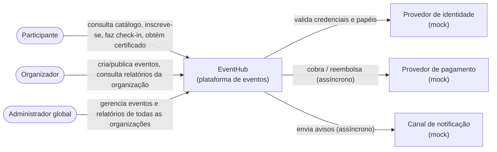
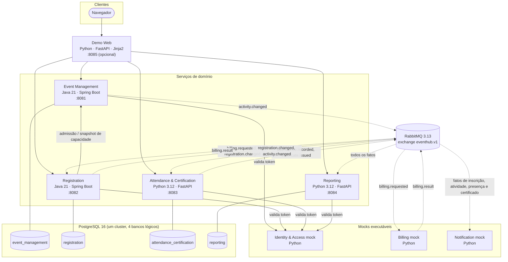
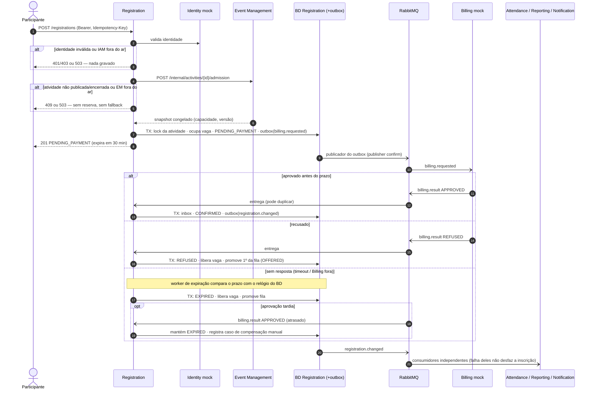
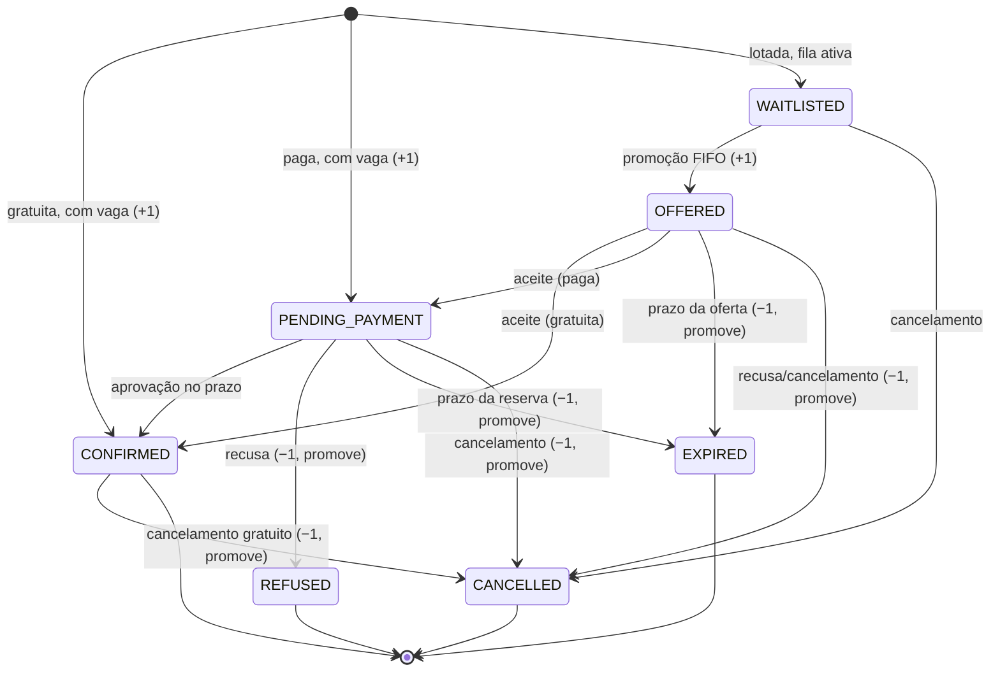
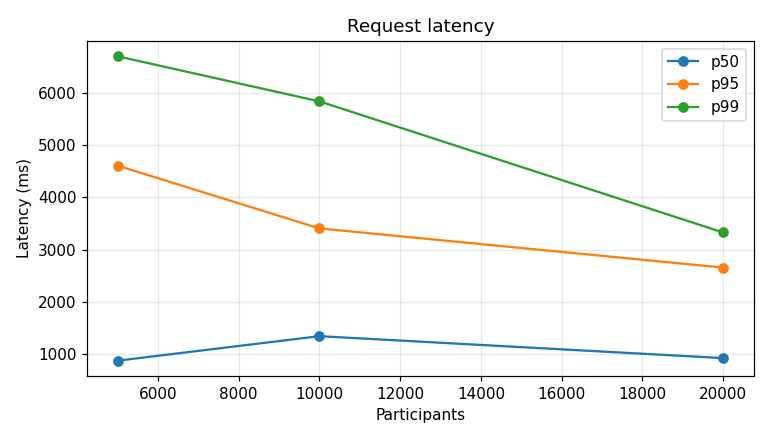
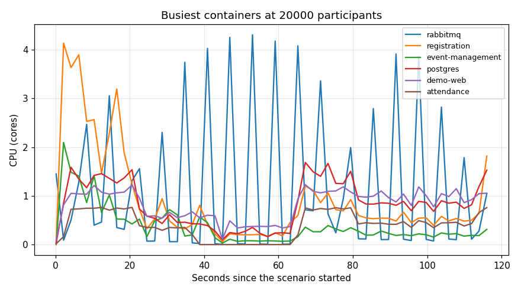
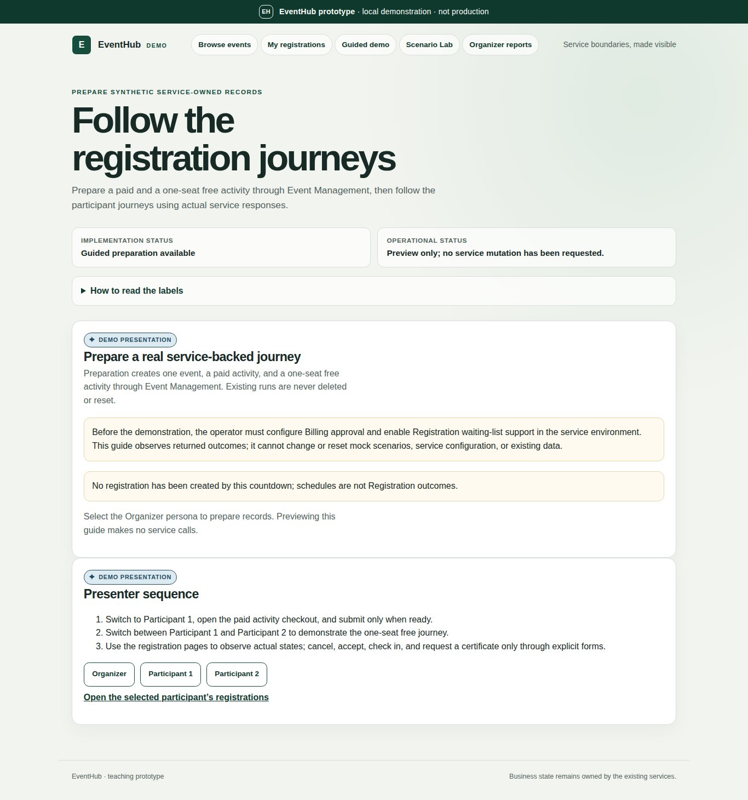
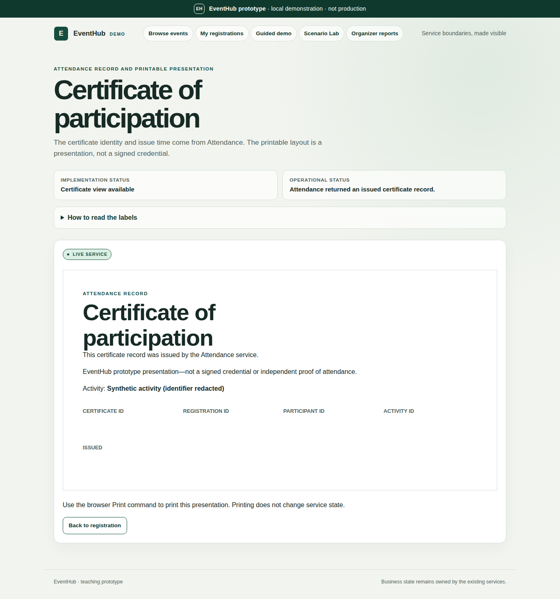

# EventHub — Relatório Arquitetural

| | |
|---|---|
| **Instituição** | Universidade Estadual do Ceará (UECE) |
| **Disciplina** | Arquitetura de Software |
| **Professor(a)** | Paulo Henrique Maia |
| **Equipe** | Anderson Gomes, Felipe Rodrigues, Tiago Magalhães |
| **Data** | 13/11/2026 |
| **Repositório** | `nosredna123/uece_2026-2_arq_trab2` |

> Este documento é o relatório arquitetural do trabalho. As instruções de
> execução local estão no
> [guia de execução local](docs/development/running-locally.md).

## Sumário

1. [Introdução e escopo](#1-introdução-e-escopo)
2. [Forças arquiteturais](#2-forças-arquiteturais)
3. [Decomposição e granularidade](#3-decomposição-e-granularidade)
4. [Diagramas](#4-diagramas)
5. [Dados e consistência](#5-dados-e-consistência)
6. [Contratos e comunicação](#6-contratos-e-comunicação)
7. [Padrões adotados e rejeitados](#7-padrões-adotados-e-rejeitados)
8. [Decisões arquiteturais (ADRs)](#8-decisões-arquiteturais-adrs)
9. [Implementação](#9-implementação)
10. [Evidências de validação](#10-evidências-de-validação)
11. [Trade-offs: o que ganhamos e o que pagamos](#11-trade-offs-o-que-ganhamos-e-o-que-pagamos)
12. [Limitações e trabalhos futuros](#12-limitações-e-trabalhos-futuros)
13. [Referências](#13-referências)
- [Anexo A — ADRs completos](#anexo-a--adrs-completos)
- [Anexo B — Declaração de uso de IA](#anexo-b--declaração-de-uso-de-ia)
- [Anexo C — Índice de evidências e reprodução](#anexo-c--índice-de-evidências-e-reprodução)

---

## 1. Introdução e escopo

O **EventHub** é uma plataforma para organizar eventos acadêmicos e
corporativos. Ela permite:

- publicar eventos e atividades com vagas limitadas;
- fazer inscrições gratuitas ou pagas;
- manter uma lista de espera em ordem de chegada (FIFO);
- registrar presença (check-in) e emitir certificados;
- consultar relatórios por organização.

A [especificação](especificação-preliminar-sistema.md) pede três coisas:

1. uma análise arquitetural para uma solução distribuída (Parte I);
2. um protótipo executável com 4 a 6 serviços em pelo menos duas tecnologias
   (Parte II);
3. a validação experimental das decisões (Parte III).

O protótipo entregue tem estas partes:

- **Quatro serviços de domínio executáveis:**
  - Event Management e Registration, em Java 21 com Spring Boot;
  - Attendance & Certification e Reporting, em Python 3.12 com FastAPI.
- **Três *mocks* executáveis com contrato:** Identity & Access, Billing e
  Notification.
- **Infraestrutura real:** PostgreSQL 16 e RabbitMQ 3.13, orquestrados por
  Docker Compose.
- **Uma aplicação web de demonstração** (Python, opcional). É apenas um
  adaptador de apresentação e não tem dados de domínio.

O fluxo de ponta a ponta exercitado é: catálogo → inscrição paga → pagamento
assíncrono → confirmação → check-in → certificado → relatório. Ele atravessa
cinco serviços e as duas tecnologias.

O sistema **não** é um produto pronto para produção. Ficaram fora do escopo:

- autenticação real;
- liquidação financeira;
- entrega de e-mail/SMS;
- alta disponibilidade.

A seção 12 lista essas limitações. O processo de engenharia está descrito em
[processo.md](processo.md): saneamento do domínio, contextos delimitados,
filtro contra *overengineering*, TDD com testes de mutação e portões de CI.

## 2. Forças arquiteturais

As forças vêm dos requisitos de qualidade (RQ01–RQ08), das regras de negócio
(RN01–RN07) e das restrições do trabalho. A tabela relaciona cada força à
decisão que a trata e à evidência que a sustenta.

| Força | Origem | Como foi tratada | Evidência |
|---|---|---|---|
| **Consistência da capacidade** (nunca vender mais vagas que o limite) | RN01, RN02, RQ04 | Uma linha de *ledger* por atividade, com `SELECT … FOR UPDATE`. A promoção FIFO ocorre na mesma transação ([ADR-003](#adr-003--consistência-das-inscrições)). | Teste de concorrência com barreira; cenários `ultima-vaga` e `pico-inscricoes` com até 20 000 participantes, sem *overbooking* (§10) |
| **Picos de inscrição** (abertura de vendas) | RQ02 | O catálogo e a inscrição são serviços separados e escaláveis. As escritas não fazem chamadas remotas enquanto seguram o *lock*. | *Sweeps* de carga de 100 a 20 000 participantes (§10.6) |
| **Isolamento de falhas** (Notificação/Relatórios não derrubam a inscrição) | RN05, RQ03 | Os consumidores assíncronos são independentes, com filas duráveis próprias ([ADR-004](#adr-004--mensageria-e-resiliência)). | Testes de falha com Reporting parado e Notification indisponível (§10.3) |
| **Pagamento externo lento ou indisponível** | RN03, RN04, RQ03 | Reserva com prazo. A ausência de resposta leva a expiração, nunca a aprovação. Uma aprovação tardia gera compensação manual. | Testes de recusa e *timeout* (§10.3) |
| **Entrega de mensagens não confiável** | RQ05, RQ06 | *Outbox* transacional, *publisher confirms*, *inbox* com deduplicação, quarentena. | Testes de contrato e de duplicidade; cenário `envios-repetidos` |
| **Segurança mínima e isolamento de dados** | RN06, RN07, RQ07 | Cada serviço valida a identidade no Identity mock e aplica sua própria autorização. Há um banco lógico por serviço, com credenciais próprias. | Testes de autorização e de configuração |
| **Rastreabilidade e diagnóstico** | RQ08 | `X-Correlation-ID` em HTTP, mensagens e logs JSON estruturados. | [observability.md](docs/validation/observability.md) |
| **Heterogeneidade tecnológica** | Parte II | Java e Python integrados só por HTTP e mensagens versionadas. Não há biblioteca de domínio compartilhada. | Fluxo pago de ponta a ponta Java ↔ Python (§10.4) |
| **Simplicidade (KISS) e custo local** | Restrição do trabalho | Docker Compose. Sem *gateway*, Kubernetes ou orquestrador de saga. | Execução em um único notebook (§10.6) |

**Tensões principais.** As forças acima entram em conflito em três pontos:

1. **Consistência forte da vaga × vazão em atividades muito disputadas.**
   - O *lock* por atividade serializa as escritas daquela atividade.
   - Isso garante o invariante, mas limita a vazão de uma atividade "quente"
     (§10.6).
2. **Isolamento × custo operacional.**
   - Cada fronteira de serviço exige contratos, filas e recuperação.
   - Esse é um custo que um monólito não teria.
3. **Disponibilidade × correção na falha de dependências.**
   - Optamos por **falhar fechado**: sem identidade válida ou sem confirmação
     da atividade, nada é gravado.
   - Isso evita *fallbacks* permissivos, ao custo de recusar pedidos durante
     indisponibilidades.

## 3. Decomposição e granularidade

### 3.1 Candidatos a serviço

Foram identificadas **sete fronteiras de capacidade de negócio** (detalhes em
[service-boundaries.md](docs/architecture/service-boundaries.md)):

| # | Serviço | Responsabilidade | Dados próprios | Situação no protótipo |
|---|---|---|---|---|
| 1 | **Event Management** | Criar, editar e publicar eventos e atividades; catálogo público; congelar a capacidade | eventos, atividades, *snapshot* de admissão | Executável (Java) |
| 2 | **Registration** | Inscrição, ocupação de vagas, reserva com pagamento, expiração, cancelamento, lista de espera FIFO | *ledger* por atividade, inscrições, fila, operações de pagamento | Executável (Java) |
| 3 | **Attendance & Certification** | Check-in idempotente e elegibilidade/emissão de certificado | projeções, check-ins, certificados | Executável (Python) |
| 4 | **Reporting** | Relatórios por organização (modelo de leitura) | projeções derivadas de eventos | Executável (Python) |
| 5 | **Identity & Access** | Autenticação e papéis (participante, organizador, administrador) | identidades sintéticas | *Mock* |
| 6 | **Billing** | Cobrança e reembolso | operações e tentativas simuladas | *Mock* |
| 7 | **Notification** | Avisos aos participantes | registros de entrega simulada | *Mock* |

### 3.2 Critérios e alternativas

Os critérios de corte foram:

1. **Fronteira de consistência.** Regras que precisam mudar juntas e de forma
   atômica ficam no mesmo serviço.
2. **Perfil de carga.** Leitura do catálogo, escrita de inscrições e relatórios
   têm picos diferentes.
3. **Domínio de falha.** Notificações e relatórios não podem bloquear a
   inscrição.
4. **Taxa de mudança e tecnologia.** Um serviço não deve depender da evolução
   de outro.

Alternativas avaliadas ([ADR-001](#adr-001--fronteiras-de-serviço)):

| Alternativa | Por que não foi escolhida |
|---|---|
| Monólito modular | É mais simples e tem transações locais. Porém não demonstra implantação independente, tecnologias heterogêneas, escala seletiva nem isolamento de falhas, que são objetivos do trabalho. |
| Um serviço por requisito (RF) | Separaria capacidade, reserva, expiração e lista de espera, que formam **um só invariante**. Cada mudança de vaga viraria uma transação distribuída. |
| **Sete fronteiras de capacidade, 4 + 3 *mocks*** (escolhida) | Separa os domínios de carga e de falha e mantém o invariante da vaga em um único serviço. |

**Por que Registration não foi dividido.** Inscrição, pagamento pendente,
expiração, cancelamento e promoção da fila alteram a **mesma contagem de vagas
ocupadas**. Dividi-los exigiria um *lock* distribuído ou uma saga para cada
transição de vaga.

Por isso Registration é deliberadamente o maior serviço. Ele concentra a
máquina de estados e usa transações locais do PostgreSQL. Attendance e
Certification também ficaram juntos, porque compartilham a evidência de
presença e o mesmo ciclo de vida.

**Por que três *mocks*.** Identidade, pagamento e entrega reais são
integrações externas. Implementá-las diluiria a demonstração arquitetural
([ADR-005](#adr-005--escopo-do-protótipo-e-segurança-mínima)).

Os *mocks* são processos reais com contrato, persistência mínima e cenários
configuráveis:

- identidade inválida;
- pagamento recusado;
- *timeout*;
- indisponibilidade.

Assim as falhas são reproduzíveis.

## 4. Diagramas

### 4.1 Contexto (C4 nível 1)



### 4.2 Contêineres (C4 nível 2)

Linhas cheias representam HTTP síncrono. Linhas tracejadas representam
mensagens no RabbitMQ (*exchange* *topic* `eventhub.v1`).



A versão editável em PlantUML está em
[containers.puml](docs/architecture/containers.puml), exportada em
[services.png](docs/architecture/services.png).

### 4.3 Fluxo de inscrição paga (sequência, com falhas)



Respostas a cada falha de dependência
([detalhamento completo](docs/architecture/paid-registration-flow.md)):

| Falha | Comportamento | Efeito na vaga |
|---|---|---|
| Identity indisponível | Erro explícito (503). Não há acesso anônimo. | Nenhum |
| Event Management indisponível | Erro explícito. Não há dados de atividade desatualizados. | Nenhum |
| RabbitMQ indisponível após o *commit* | O *outbox* tenta de novo. A reserva continua pendente até expirar. | Vaga ocupada até o prazo |
| Billing recusa | `REFUSED`, a vaga é liberada uma única vez e a fila FIFO é promovida | Liberada |
| Billing não responde | Expira no prazo. Uma aprovação tardia vira compensação manual. | Liberada |
| Resultado duplicado ou fora de ordem | Deduplicado pela *inbox*. O estado terminal não regride. | Inalterada |
| Notification ou Reporting fora do ar | A inscrição segue normalmente. A fila durável acumula as mensagens e o consumidor alcança depois. | Inalterada |

### 4.4 Máquina de estados da inscrição



Os estados `OFFERED`, `PENDING_PAYMENT` e `CONFIRMED` ocupam uma vaga cada.
O invariante `0 ≤ ocupadas ≤ capacidade_congelada` é garantido por
transações locais e reforçado por uma *check constraint*.

## 5. Dados e consistência

**Banco por serviço.** Há um *cluster* PostgreSQL com **quatro bancos
lógicos**. Cada serviço tem credenciais próprias e roda suas próprias migrações
(Flyway em Java, Alembic em Python). Não há SQL entre serviços, *foreign keys*
entre bancos nem biblioteca de entidades compartilhada.

| Dono | Banco | Entidades principais |
|---|---|---|
| Event Management | `event_management` | `event`, `activity`, `admission_snapshot`, `command_receipt`, `outbox` |
| Registration | `registration` | `activity_ledger`, `registration`, `waitlist_entry`, `payment_operation`, `billing_attempt`, `refund_obligation`, `compensation_case`, `command_receipt`, `inbox`, `outbox` |
| Attendance & Certification | `attendance_certification` | projeções de atividade e inscrição, `check_in`, `certificate`, `inbox`, `outbox` |
| Reporting | `reporting` | projeções de atividade, inscrição, pagamento, check-in e certificado, `inbox` |

**Sincronização da capacidade.** A capacidade é configurada no Event
Management, mas a vaga é controlada pelo Registration. Na primeira admissão,
acontece o seguinte ([ADR-002](#adr-002--propriedade-dos-dados)):

1. Registration chama uma operação interna e idempotente do Event Management,
   que **congela** a capacidade e devolve um *snapshot* versionado.
2. Registration inicializa o seu *ledger* a partir desse *snapshot*.
3. Depois da ativação, a capacidade não pode mais ser alterada.

Essa escolha troca flexibilidade, isto é, poder mudar a capacidade com as
inscrições abertas, por correção sem transação distribuída.

**Consistência.** Há dois níveis:

- **Forte dentro do Registration:** existe uma única autoridade sobre as vagas.
- **Eventual nos consumidores:** Attendance e Reporting mantêm projeções
  versionadas. Elas descartam *snapshots* antigos de forma observável e nunca
  "inventam" elegibilidade. Um certificado só é emitido com inscrição
  confirmada, check-in feito e atividade encerrada, conforme os fatos
  conhecidos localmente.

**Idempotência em três camadas:**

| Camada | Chave única | Garantia |
|---|---|---|
| Comando HTTP (`command_receipt`) | sujeito + operação + `Idempotency-Key` | Um reenvio devolve a resposta original. A mesma chave com outro *payload* recebe 409. |
| Consumidor (`inbox`) | consumidor + `eventId` | O efeito e a *inbox* são gravados na mesma transação, antes do *ack*. |
| Produtor (`outbox`) | `eventId` | O evento é gravado com o estado. Pode ser publicado em duplicata, mas nunca se perde. |

A estratégia completa de retenção e migração está em
[data-ownership.md](docs/architecture/data-ownership.md).

## 6. Contratos e comunicação

**Síncrono (HTTP/JSON, OpenAPI 3).** O HTTP é usado para comandos e consultas
que precisam de resposta imediata:

- catálogo;
- inscrição;
- check-in e certificado;
- relatórios;
- validação de identidade;
- admissão interna.

Os contratos estão em [docs/contracts/openapi](docs/contracts/openapi):

- [event-management.yaml](docs/contracts/openapi/event-management.yaml);
- [registration.yaml](docs/contracts/openapi/registration.yaml);
- [attendance-certification.yaml](docs/contracts/openapi/attendance-certification.yaml);
- [reporting.yaml](docs/contracts/openapi/reporting.yaml);
- [identity-mock.yaml](docs/contracts/openapi/identity-mock.yaml);
- [common.yaml](docs/contracts/openapi/common.yaml) (erros, correlação).

Todas as chamadas HTTP entre serviços têm *timeout* limitado (5 s,
configurável). Não há novas tentativas automáticas sem contrato de
idempotência.

**Assíncrono (AMQP, AsyncAPI).** O AMQP é usado para pagamento e para fatos de
domínio. A especificação está em
[eventhub.yaml](docs/contracts/asyncapi/eventhub.yaml), e o comportamento de
filas e quarentena em [asyncapi/README.md](docs/contracts/asyncapi/README.md).

| Chave de roteamento | Produtor | Consumidores |
|---|---|---|
| `billing.requested` | Registration | Billing |
| `billing.result` | Billing | Registration, Reporting |
| `registration.changed` | Registration | Attendance, Reporting, Notification |
| `activity.changed` | Event Management | Attendance, Reporting, Notification |
| `attendance.recorded` | Attendance | Reporting, Notification |
| `certificate.issued` | Attendance | Reporting, Notification |

Cada consumidor tem a própria fila durável (`billing.v1`, `registration.v1`,
`attendance.v1`, `reporting.v1`, `notification.v1`) e uma fila de quarentena
(`<fila>.quarantine`). Todas as mensagens usam o mesmo envelope:

- `eventId`;
- `eventType`;
- `schemaVersion`;
- `aggregateId`;
- `aggregateVersion`;
- `correlationId`;
- `occurredAt`;
- `producer`;
- `data`.

O envelope está definido em
[envelope.json](docs/contracts/schemas/envelope.json).

**Critério de escolha.** Usamos chamadas síncronas apenas quando o resultado é
necessário para responder ao usuário **e** a dependência faz parte da decisão.
Isso vale para a identidade e a elegibilidade da atividade. O restante é
assíncrono:

- o pagamento, que é lento e externo;
- as notificações;
- as projeções.

Assim, uma lentidão do Billing ou do Reporting não aumenta a latência da
inscrição.

**Correlação.** O `X-Correlation-ID` é aceito ou gerado em cada requisição. O
mesmo valor é:

- devolvido na resposta e nos corpos de erro;
- propagado em `correlationId` e no `correlation_id` AMQP;
- registrado nos logs JSON (formato ECS no Java).

Os logs nunca contêm tokens ou corpos de requisição
([observability.md](docs/validation/observability.md)).

## 7. Padrões adotados e rejeitados

| Padrão | Situação | Onde e por quê |
|---|---|---|
| **Database per Service** | Adotado | Quatro bancos lógicos com credenciais restritas. Separa as migrações e a autorização ([ADR-002](#adr-002--propriedade-dos-dados)). |
| **Transactional Outbox** | Adotado | Registration, Event Management e Attendance gravam o evento junto com o estado. O publicador usa *publisher confirms* e marca a mensagem como publicada só depois da confirmação ([ADR-004](#adr-004--mensageria-e-resiliência)). |
| **Publish/Subscribe** | Adotado | *Exchange* *topic* `eventhub.v1`, com uma fila durável por consumidor. Um consumidor fora do ar não afeta os demais. |
| **Idempotent Consumer / Inbox** | Adotado | Entrega *at-least-once* com efeito idempotente. O *ack* só acontece depois do *commit*. |
| **Idempotency Key** | Adotado | Comandos de escrita no Registration e no Attendance. O cenário `envios-repetidos` demonstra o reenvio. |
| **Pessimistic Lock (por agregado)** | Adotado | `SELECT … FOR UPDATE` no *ledger* da atividade substitui uma saga ou 2PC para a vaga ([ADR-003](#adr-003--consistência-das-inscrições)). |
| **Timeout + expiração (deadline)** | Adotado | É o mecanismo de resiliência contra o Billing. A reserva expira e libera a vaga. Um resultado tardio vira compensação. |
| **Dead-letter / Quarentena** | Adotado | Mensagens inválidas ou persistentemente impossíveis de processar vão para uma fila durável de quarentena, para reparo explícito. |
| **Read Model (CQRS leve)** | Adotado | Reporting mantém projeções alimentadas por eventos. As consultas não atingem os serviços de escrita. |
| **Correlation ID** | Adotado | Rastreia o fluxo entre HTTP, mensagens e logs. |
| **Saga (orquestrada/coreografada)** | Não adotado | A autoridade da vaga está em um único banco. O "fluxo de pagamento" é a máquina de estados do Registration com compensação local (expiração, compensação manual). Uma plataforma de saga seria infraestrutura sem ganho. |
| **Two-Phase Commit / lock distribuído** | Rejeitado | Acrescenta modos de falha e acoplamento de disponibilidade. Não é necessário com o *snapshot* congelado. |
| **API Gateway** | Não adotado | São quatro APIs locais e cada serviço já aplica sua autorização. Um *gateway* seria mais um ponto de falha sem requisito que o justifique. A Demo Web **não** é um *gateway*. |
| **Circuit Breaker** | Adiado | Os *timeouts* limitados e a recuperação durável cobrem os casos do protótipo. As medições (§10.6) não mostraram falhas em cascata que justificassem o padrão. Ele fica como evolução se houver novas tentativas síncronas. |

## 8. Decisões arquiteturais (ADRs)

Resumo. O texto completo em português está no
[Anexo A](#anexo-a--adrs-completos). Os originais versionados (em inglês)
estão em [docs/adr](docs/adr), e os *rationales* legíveis por máquina em
[docs/rationales](docs/rationales).

| ADR | Decisão | Principal alternativa rejeitada | Consequência principal |
|---|---|---|---|
| [001](#adr-001--fronteiras-de-serviço) | Sete fronteiras de capacidade: 4 serviços executáveis e 3 *mocks* | Monólito modular; um serviço por RF | Registration é maior de propósito; os contratos passam a ser responsabilidade operacional |
| [002](#adr-002--propriedade-dos-dados) | Um banco lógico por serviço; *snapshot* de capacidade congelado e idempotente | Esquema compartilhado; capacidade "ao vivo" coordenada | A capacidade fica imutável após a ativação; o cluster é um domínio de falha comum |
| [003](#adr-003--consistência-das-inscrições) | *Lock* de linha por atividade, READ COMMITTED, FIFO na mesma transação, prazo pelo relógio do BD | Contar e inserir; *lock* distribuído / 2PC / saga | Não há *overbooking*; uma atividade "quente" serializa as escritas |
| [004](#adr-004--mensageria-e-resiliência) | *Outbox* transacional, *confirms*, *at-least-once*, *inbox*, quarentena | Chamadas síncronas a Billing e Notification; publicar sem *outbox* | Duplicatas são esperadas; consistência eventual; *backlog* após falhas |
| [005](#adr-005--escopo-do-protótipo-e-segurança-mínima) | Quatro serviços persistentes e três *mocks* com contrato; autorização em cada serviço | Sete serviços de produção; *stubs* em memória | Não prova segurança nem pagamento reais; o reembolso pago fica como limitação |
| [006](#adr-006--aplicação-web-de-demonstração) | Web de demonstração em Python renderizada no servidor, sem estado de domínio | SPA com Node; *gateway* com sessão compartilhada | As sessões ficam em memória, em um único processo |

## 9. Implementação

| Componente | Tecnologia | Persistência | Destaques |
|---|---|---|---|
| Event Management | Java 21, Spring Boot, Flyway | PostgreSQL | Catálogo público; escopo por organização; *snapshot* de admissão; *outbox* |
| Registration | Java 21, Spring Boot, Flyway | PostgreSQL | *Ledger* com *lock*; máquina de estados; *workers* de expiração e de *outbox*; consumidor de `billing.result` |
| Attendance & Certification | Python 3.12, FastAPI, SQLAlchemy, Alembic | PostgreSQL | Check-in idempotente; certificado; projeções; *outbox* |
| Reporting | Python 3.12, FastAPI, SQLAlchemy, Alembic | PostgreSQL | Projeções idempotentes; relatórios paginados por organização |
| Identity / Billing / Notification | Python (*mocks*) | Arquivos/volumes próprios | Cenários configuráveis: aprovado, recusado, *timeout*, indisponível |
| Demo Web | Python, FastAPI, Jinja2, HTTPX | Sessão em memória | *Personas* sintéticas; painel de indicadores; cenários de carga via terminal (`scripts/cenario.sh`) |
| Infraestrutura | Docker Compose, PostgreSQL 16.6, RabbitMQ 3.13.7 | Volumes nomeados | *Health checks*; perfis `test` e `acceptance` |

**Segurança mínima.** Cada serviço protegido valida o *bearer token* no
Identity mock e aplica o escopo:

- o participante acessa apenas os próprios recursos;
- o organizador acessa apenas a própria organização;
- o administrador global gerencia eventos e relatórios de todas as
  organizações, mas não usuários.

Dados de identidade enviados no corpo da requisição nunca são confiáveis. As
rotas internas exigem uma credencial de serviço. Os segredos ficam em
`infra/.env`, que é ignorado pelo Git e validado por um *schema* na
inicialização.

**Qualidade.** Os portões de qualidade são:

- TDD;
- testes de mutação de ≥ 95% no núcleo de domínio (PIT no Java, mutmut no
  Python);
- *import-linter* e testes de arquitetura, que impedem dependências entre
  serviços;
- *ruff*;
- testes de contrato OpenAPI/AsyncAPI;
- CI com auditoria semântica.

**Como executar** (detalhes no
[guia de execução local](docs/development/running-locally.md)):

```sh
cp infra/.env.example infra/.env && chmod 600 infra/.env
bash scripts/run-demo-web.sh          # sobe toda a pilha + web em http://localhost:8085
bash scripts/cenario.sh               # cenários de carga em paralelo
bash scripts/benchmark.sh             # varredura de carga com relatório em CSV/Markdown
```

## 10. Evidências de validação

### 10.1 Testes automatizados

| Conjunto | Resultado | Observação |
|---|---|---|
| Suíte Python do repositório (contratos, documentação, configuração, serviços, *mocks*, web, *benchmark*) | **486 aprovados, 9 ignorados** (`pytest -x`) | Os testes ignorados dependem do ambiente e têm executores próprios (abaixo) |
| Testes Java (Event Management, Registration) | Aprovados no *build* do perfil `test` | Executados no estágio de teste das imagens Docker |
| Aceitação no navegador (Demo Web) | 4 aprovados, 2 ignorados; testes de indisponibilidade: 2 aprovados | [webapp-evidence.md](docs/validation/webapp-evidence.md) |
| Fluxo pago de ponta a ponta ao vivo | 1 aprovado | [paid-registration-flow](tests/integration/paid-registration-flow) |

### 10.2 Concorrência (sem *overbooking*)

[tests/concurrency](tests/concurrency/README.md) sincroniza dois participantes
em uma barreira para disputar **uma** vaga. O resultado foi:

- exatamente um ficou `CONFIRMED` e o outro `WAITLISTED`;
- depois do cancelamento do vencedor, o segundo passou a `OFFERED`;
- durante o teste, a disponibilidade foi amostrada continuamente e
  `ocupadas ≤ capacidade` valeu em todas as amostras.

Em escala maior, dois cenários executáveis checam o mesmo invariante:

- `ultima-vaga`: vários participantes disputam a última vaga;
- `pico-inscricoes`: até **20 000** participantes disputam uma atividade com
  25% de vagas.

Ambos verificam `ocupadas ≤ capacidade` e que o número de confirmados é igual
a `min(capacidade, pedidos)`. Todas as execuções registradas tiveram veredito
**OK**.

### 10.3 Falhas de dependência

[tests/integration/failure-scenarios](tests/integration/failure-scenarios/README.md)
roda com a pilha real e verifica quatro situações:

- **Billing recusa.** A reserva é liberada e o primeiro da fila recebe uma
  oferta.
- **Billing não responde.** A reserva expira e a vaga é liberada.
- **Notification indisponível.** A inscrição é confirmada mesmo assim.
- **Reporting parado.** A inscrição é concluída. Ao reiniciar o Reporting, a
  fila durável recompõe o relatório.

Os testes de navegador também derrubam o Reporting e o Identity. A interface
mostra um erro que identifica o serviço e o `correlationId`, sem falso sucesso.

### 10.4 Integração entre tecnologias (Java ↔ Python)

O executor do fluxo pago atravessa cinco serviços:

1. cria um evento pago (Event Management, Java);
2. inscreve um participante (Registration, Java);
3. o pagamento é aprovado de forma assíncrona (Billing mock, Python, via
   RabbitMQ);
4. o participante faz check-in e obtém o certificado (Attendance, Python);
5. o relatório é verificado (Reporting, Python).

Também são verificados o `correlationId` nas respostas e nos erros.

### 10.5 Testes de mutação (núcleo de domínio)

| Serviço | Núcleo testado | *Score* |
|---|---|---:|
| Event Management | `EventManagementPolicy` | 100% |
| Registration | `CapacityPolicy`, `WaitlistPolicy` | 95% |
| Attendance & Certification | `domain.py` (elegibilidade) | 100% |
| Reporting | `domain.py` (agregação) | 97,30% |

Os adaptadores (HTTP, persistência, mensageria) ficam fora do denominador. Eles
são cobertos por testes de contrato e de integração
([mutation-testing.md](docs/validation/mutation-testing.md)).

### 10.6 Carga e escalabilidade

**Linha de base (2 → 40 usuários virtuais).** Todas as 840 requisições foram
bem-sucedidas. Com 20 vezes mais concorrência:

- a consulta ao catálogo foi de 519 a 1 664 req/s (3,2×);
- a inscrição foi de 55,6 a 252,6 req/s (4,5×);
- o p95 da inscrição subiu só 1,6× ([evidence.md](docs/validation/evidence.md)).

**Varreduras com recursos do *host* (`scripts/benchmark.sh`).** A ferramenta
faz o seguinte em cada execução:

1. restaura os dados;
2. executa os cenários com N participantes;
3. amostra a CPU e a memória dos contêineres e do *host*, incluindo a pressão
   de CPU, memória e disco (`/proc/pressure`);
4. classifica o limite como *host* (máquina saturada), *noisy* (outros
   programas competindo) ou *architecture* (havia folga, então o limite vem do
   desenho da pilha).

Todas as varreduras rodaram em um Ryzen 7 5800H com 16 CPUs lógicas e
58,7 GiB.

*(a) Todos os cenários em paralelo, 20 conexões*
([relatório](docs/validation/benchmarks/20261112-171442/report.md)):

| Participantes | Veredito | Req/s | p50 / p95 / p99 (ms) | Pico de CPU (núcleos) | *Catch-up* do Reporting |
|---:|---|---:|---|---:|---:|
| 100 | OK | 25,9 | 14 / 26 / 97 | 2,97 | 1,4 s |
| 500 | OK | 152,6 | 28 / 88 / 136 | 9,93 | 1,3 s |
| 1 000 | OK | 217,9 | 63 / 142 / 197 | 11,24 | 1,3 s |
| 2 000 | VERIFICAR | 234,4 | 78 / 154 / 240 | 11,74 | 1,4 s |

Em 2 000 participantes, o gerador de carga (20 conexões) aceitou ofertas da
fila depois do prazo. Isso foi um limite do **cliente**, não uma violação de
invariante. Depois de corrigir o gerador e subir para 200 conexões, a varredura
(b) passou.

*(b) Todos os cenários em paralelo, 200 conexões*
([runs.csv](docs/validation/benchmarks/20261112-190017/runs.csv)):

| Participantes | Veredito | Duração | Req/s | p95 (ms) | Falhas | Limite |
|---:|---|---:|---:|---:|---:|---|
| 2 000 | OK | 286 s | 209,5 | 1 310 | 0 | *architecture* |
| 3 000 | OK | 518 s | 218,6 | 1 218 | 0 | *architecture* |
| 5 000 | OK | 659 s | 211,6 | 1 362 | 0 | *architecture* |

*(c) Somente o pico de inscrições, 200 conexões*
([relatório](docs/validation/benchmarks/20261112-193747/report.md)):

| Participantes | Veredito | Duração | Req/s | p50 / p95 / p99 (ms) | Reenvios | *Catch-up* | CPU do *host* (média) | Limite |
|---:|---|---:|---:|---|---:|---:|---:|---|
| 5 000 | OK | 37,9 s | 134,5 | 870 / 4 610 / 6 707 | 0 | 157 s | 44% | *architecture* |
| 10 000 | OK | 74,7 s | 135,3 | 1 340 / 3 406 / 5 842 | 0 | 110 s | 34% | *architecture* |
| 20 000 | OK | 116,1 s | 173,6 | 919 / 2 655 / 3 328 | 5 | 69 s | 40% | *architecture* |




**Análise crítica dos resultados:**

1. **O invariante resistiu a toda a carga.**
   - Nenhuma execução registrou *overbooking*.
   - Também não houve inscrição duplicada, nem mesmo nos 5 reenvios por
     *timeout* com a mesma `Idempotency-Key` em 20 000 participantes.
2. **O limite foi a arquitetura, não a máquina.**
   - A CPU do *host* ficou em média entre 34% e 44%, sem saturação e sem
     espera relevante por memória ou disco.
   - A vazão estabilizou em cerca de 210–235 req/s com carga mista, e o p95
     subiu de 26 ms para cerca de 1,3 s.
   - Isso é coerente com **uma instância por serviço** e com o *lock* por
     atividade.
3. **O pico concentra tudo em uma atividade.**
   - No cenário `pico-inscricoes`, todas as escritas disputam o *mesmo*
     *ledger*.
   - O p95 de 2,7–4,6 s mostra o custo da serialização escolhida na
     ADR-003. É o preço explícito de "nunca vender vaga a mais".
   - Mesmo assim, 20 000 pedidos foram atendidos em menos de 2 minutos.
4. **Gargalos por contêiner.**
   - No pico, o RabbitMQ (até 4,3 núcleos) e o Registration (até 4,1) foram
     os mais exigidos. Isso reflete a publicação via *outbox* e o consumo de
     resultados de pagamento.
   - Na carga mista, o Attendance teve a maior CPU média (1,18 núcleo). Ele
     roda como um único processo Uvicorn, então é o primeiro candidato a mais
     *workers* ou réplicas.
5. **Consistência eventual mensurável.**
   - Com carga mista, o Reporting alcançou o estado real em cerca de 1–7 s
     após o fim do cenário.
   - No pico concentrado, isso levou de 69 a 157 s.
   - O *backlog* de eventos é o custo visível de desacoplar os relatórios. A
     inscrição nunca esperou por ele.
   - Nossa hipótese para o *catch-up* menor nas execuções mais longas é que o
     consumidor drena a fila enquanto o cenário ainda está em andamento.

Esses resultados vêm de um único notebook. Eles são comparativos e
reproduzíveis, mas não constituem uma promessa de capacidade em produção.

### 10.7 Capturas de tela

| Página do organizador (projetor) | Registro de certificado |
|---|---|
|  |  |

As exportações JSON dos cenários (`scenario-*.json`) e a versão móvel estão em
[artifacts/webapp](docs/validation/artifacts/webapp).

## 11. Trade-offs: o que ganhamos e o que pagamos

| Ganhamos | Pagamos |
|---|---|
| **Isolamento de falhas.** Notification, Reporting e Billing podem cair sem desfazer ou bloquear inscrições (§10.3). | **Consistência eventual.** O relatório pode atrasar segundos ou minutos (§10.6), e a interface precisa explicar isso. |
| **Escala e evolução independentes.** Catálogo, inscrição e relatórios têm perfis de carga distintos, e cada serviço pode ganhar réplicas ou mudar de tecnologia. | **Mais peças em movimento.** São 7 serviços, 2 *brokers*/bancos, 6 contratos e 6 tópicos, com *outbox*, *inbox* e quarentena para operar. |
| **Heterogeneidade real** (Java e Python) sem biblioteca compartilhada. | **Duplicação deliberada.** Projeções e validações ficam repetidas em cada serviço. |
| **Correção da vaga sem transação distribuída**, graças ao *snapshot* congelado e ao *lock* local. | A capacidade fica **imutável após a ativação**, e uma atividade disputada serializa as escritas (p95 de segundos no pico). |
| **Recuperação durável.** O *outbox* e as filas duráveis transformam falhas de rede em atraso, não em perda. | **Duplicatas e reordenação são normais.** Tudo precisa ser idempotente e versionado, e os testes ficam mais caros. |
| **Rastreabilidade ponta a ponta** com o *correlation ID*. | Diagnóstico distribuído: é preciso correlacionar logs de vários processos. |
| **Falha fechada** em identidade e elegibilidade, sem *fallbacks* inseguros. | Menor disponibilidade percebida quando o Identity ou o Event Management caem. |

**Síntese.** Distribuir o sistema valeu a pena para as forças que o enunciado
prioriza: picos, isolamento de falhas e independência tecnológica.

O núcleo crítico, a vaga, foi mantido **não distribuído** dentro do
Registration. Essa foi a decisão mais importante. Ela permite a consistência
forte onde ela é obrigatória e a consistência eventual em todo o resto.

## 12. Limitações e trabalhos futuros

**Reembolso de inscrição paga confirmada.**

- O fluxo está projetado, e o contrato e o Billing mock já existem.
- Porém o Registration responde `409 REFUND_WORKFLOW_REQUIRED` e mantém a
  vaga. A falha é fechada: nenhuma vaga paga é liberada sem reembolso.
- Implementar requer:
  - guardar o ID do pagamento;
  - verificar a janela de 7 dias;
  - enviar o `REFUND` pelo *outbox*;
  - fazer novas tentativas sem limite;
  - liberar a vaga e promover a fila de forma idempotente.

**Outras limitações:**

- **Capacidade imutável após a ativação.** Mudá-la exigiria um protocolo de
  coordenação com *fencing*.
- **Instância única por serviço e um único cluster PostgreSQL.** Não há alta
  disponibilidade, e o cluster é um domínio de falha comum.
- ***Mocks*.** Eles não provam autenticação, pagamento ou entrega reais.
- **Sem retenção ou expurgo.** Não há expurgo automático de *inbox*, *outbox*
  e recibos.
- **Sessões em memória na Demo Web.** Há um único *worker*.

**Evolução sugerida pelas medições:**

1. Múltiplos *workers* ou réplicas para o Attendance e o Registration (o *lock*
   continua no banco).
2. Lotes no publicador do *outbox* para reduzir a carga no RabbitMQ.
3. Paralelismo no consumidor do Reporting para reduzir o *catch-up*.
4. Um *circuit breaker* caso surjam novas tentativas síncronas.
5. Um *gateway* caso surjam clientes externos.

## 13. Referências

- Especificação do trabalho: [especificação-preliminar-sistema.md](especificação-preliminar-sistema.md).
- Processo de engenharia assistido por IA: [processo.md](processo.md); constituição: [constitution.md](constitution.md); plano: [plan.md](plan.md).
- Arquitetura: [context-map.md](docs/architecture/context-map.md), [service-boundaries.md](docs/architecture/service-boundaries.md), [data-ownership.md](docs/architecture/data-ownership.md), [paid-registration-flow.md](docs/architecture/paid-registration-flow.md), [domain-scenarios.md](docs/architecture/domain-scenarios.md).
- RICHARDSON, C. *Microservices Patterns*. Manning, 2018 (Database per Service, Transactional Outbox, Saga, Idempotent Consumer, API Gateway).
- NEWMAN, S. *Building Microservices*. 2. ed. O'Reilly, 2021.
- EVANS, E. *Domain-Driven Design*. Addison-Wesley, 2003 (contextos delimitados).
- NYGARD, M. *Release It!* 2. ed. Pragmatic Bookshelf, 2018 (*timeouts*, *circuit breaker*).
- KLEPPMANN, M. *Designing Data-Intensive Applications*. O'Reilly, 2017 (consistência, entrega *at-least-once*).
- NYGARD, M. *Documenting Architecture Decisions*, 2011 (formato de ADR).
- BROWN, S. *The C4 model for visualising software architecture*. <https://c4model.com>.
- PostgreSQL 16 — *Explicit Locking*; RabbitMQ — *Publisher Confirms*; AsyncAPI 3.0; OpenAPI 3.1.

---

## Anexo A — ADRs completos

Tradução e consolidação dos ADRs versionados em [docs/adr](docs/adr). O
formato de cada ADR é: contexto, alternativas, decisão, evidências,
justificativa e consequências.

### ADR-001 — Fronteiras de serviço

**Status:** aceito · **Rastreabilidade:** RF01–RF11, RN01–RN07, RQ01–RQ08

**Contexto.** O EventHub precisa suportar picos de inscrição, isolamento de
falhas e evolução independente. O trabalho exige de 4 a 6 serviços em pelo
menos duas tecnologias. As regras de capacidade, reserva, expiração e lista de
espera mexem no mesmo contador de vagas.

**Alternativas.**

| Alternativa | Benefícios | Custos / motivo da rejeição |
|---|---|---|
| Monólito modular | Implantação simples e transações locais. | Não demonstra serviços independentes e heterogêneos nem escala seletiva. |
| Um serviço por requisito | *Endpoints* pequenos. | Separa regras acopladas de capacidade, expiração e fila, e adiciona transações de rede sem capacidades independentes. |
| **Sete fronteiras de capacidade, 4 implementadas e 3 *mocks*** | Separa os domínios de carga e de falha e mantém as regras atômicas da inscrição juntas. | Exige contratos explícitos, recuperação assíncrona e distinção clara entre *mock* e serviço real. |

**Decisão.**

- **Event Management:** cuida da criação e do ciclo de vida de eventos e
  atividades e do catálogo público.
- **Registration:** cuida da admissão, da capacidade ocupada, dos pagamentos e
  reembolsos, da expiração, do cancelamento, das ofertas FIFO e do *outbox*.
  Esse conjunto não será dividido.
- **Attendance & Certification:** une check-in e certificado.
- **Reporting:** mantém o próprio modelo de leitura.
- **Identity, Billing e Notification:** são *mocks* com contrato.

Event Management e Registration são escritos em Java/Spring Boot, e Attendance
e Reporting em Python/FastAPI. Não há biblioteca de domínio compartilhada nem
SQL entre serviços. Notification e Reporting nunca são portões síncronos da
inscrição.

**Evidências.**

- As regras RN01–RN05 da especificação.
- Os cenários de domínio aprovados ([domain-scenarios.md](docs/architecture/domain-scenarios.md)).
- As medições de carga da §10.6, que mostraram perfis de CPU distintos por
  serviço.

**Justificativa.** O corte segue as fronteiras de consistência. Onde o
invariante exige atomicidade, o serviço é único. Onde a carga e a falha são
independentes, os serviços são separados.

**Consequências.**

- Catálogo e inscrição podem escalar separadamente de certificados e
  relatórios.
- Registration fica intencionalmente maior.
- Contratos, atraso de projeções e *replay* viram responsabilidades
  operacionais.
- Os *mocks* não provam segurança, pagamento ou entrega reais.

### ADR-002 — Propriedade dos dados

**Status:** aceito · **Rastreabilidade:** RF02–RF11, RN01–RN07, RQ04–RQ07

**Contexto.** O Event Management configura a capacidade. A vaga, porém,
precisa ser controlada por quem admite: o Registration. Compartilhar tabelas
acoplaria as migrações e burlaria a autorização.

**Alternativas.**

| Alternativa | Benefícios | Custos / motivo da rejeição |
|---|---|---|
| Esquema compartilhado com SQL entre serviços | *Joins* e transações globais. | Viola a propriedade dos dados e acopla as migrações. |
| Instalações físicas separadas | Isolamento forte. | Custo local desnecessário para o protótipo. |
| **Bancos lógicos separados e *snapshot* de admissão imutável** | Controle atômico local e propriedade explícita. | A capacidade não pode mudar após a ativação. |
| Capacidade "ao vivo" coordenada entre serviços | Permite alterar a capacidade durante as inscrições. | Exige *fencing* e coordenação recuperável. Foi adiada. |

**Decisão.**

1. Há um *cluster* com quatro bancos lógicos. Cada um tem credenciais de
   execução restritas e migrações próprias (Flyway ou Alembic).
2. Na primeira admissão, o Event Management **congela** a capacidade em uma
   operação interna idempotente, que devolve o *snapshot*, a versão e a
   capacidade.
3. O Registration inicializa o seu *ledger* a partir desse *snapshot*:
   - um *snapshot* conflitante gera erro;
   - uma nova tentativa usa o mesmo *snapshot*;
   - não há "descongelamento" automático.
4. Depois disso, mudanças de capacidade são rejeitadas.
5. Novas inscrições ainda revalidam a publicação da atividade. Se o Event
   Management estiver fora do ar, não há admissão nem *fallback*.
6. A disponibilidade é calculada pelo Registration.

**Evidências.**

- Os cenários aprovados exigem dados por serviço.
- Os testes de configuração verificam as credenciais por serviço.
- O fluxo e as varreduras de carga funcionaram sem acesso a bancos alheios.

**Justificativa.** O *snapshot* congelado elimina a necessidade de uma
transação distribuída entre configuração e admissão.

**Consequências.**

- Uma edição concorrente não reduz a capacidade de reservas já gravadas.
- Pode sobrar uma atividade congelada sem inscrições, caso a primeira admissão
  falhe.
- O PostgreSQL é um domínio de falha comum.
- A capacidade "ao vivo" é uma limitação declarada.

### ADR-003 — Consistência das inscrições

**Status:** aceito · **Rastreabilidade:** RF04–RF08, RN01–RN04, RQ04

**Contexto.** Pedidos concorrentes pela última vaga, a expiração, os
resultados de pagamento e a promoção da fila disputam o mesmo contador. Não se
pode vender vaga a mais nem furar a fila.

**Alternativas.**

| Alternativa | Benefícios | Custos / motivo da rejeição |
|---|---|---|
| Contar vagas e depois inserir | Pouco código. | Pedidos concorrentes veem a mesma vaga livre: *overbooking*. |
| Atualizações condicionais/versionadas | Limite atômico de um contador. | Transições de várias linhas (FIFO, expiração, reembolso) exigiriam novas tentativas coordenadas. É uma alternativa futura se a contenção justificar. |
| ***Lock* de linha por atividade no PostgreSQL** | Uma fronteira transacional clara para o *ledger* e a fila. | Serializa uma atividade "quente". |
| *Lock* distribuído, 2PC ou saga | Coordena vários bancos. | Adiciona modos de falha. Toda a autoridade já está em um único banco. |

**Decisão.** Toda transição que afeta a vaga segue estas regras:

1. Executa `SELECT … FOR UPDATE` na linha da atividade, em READ COMMITTED.
2. Lê o estado só depois de obter o *lock*.
3. Segue a ordem fixa: atividade e depois inscrições.
4. Não faz E/S de rede enquanto segura o *lock*.

Na mesma transação, ela:

- valida a idempotência;
- aplica `0 ≤ ocupadas ≤ capacidade`;
- grava o estado e o *outbox*;
- ao liberar uma vaga, promove o próximo da fila FIFO.

Há ainda regras de prazo e de cancelamento pago:

- O prazo da reserva é avaliado com o relógio do banco **após** obter o
  *lock*. Uma aprovação no prazo ou depois dele não confirma: a reserva expira
  e o caso vira compensação manual.
- O cancelamento pago mantém a vaga até o reembolso ser aprovado. As novas
  tentativas são ilimitadas, com janela de 7 dias e reembolso de 90%.
  **O reembolso ainda não está implementado (ver ADR-005).**

**Evidências.**

- O teste de concorrência com barreira (§10.2).
- Os cenários `ultima-vaga` e `pico-inscricoes` (até 20 000 participantes).
- Os testes de mutação de `CapacityPolicy` e `WaitlistPolicy` (95%).

**Justificativa.** Esta é a forma mais simples que garante o invariante e a
ordem FIFO juntos, usando uma tecnologia já presente.

**Consequências.**

- Várias réplicas do Registration compartilham a mesma autoridade, que fica no
  banco.
- Uma atividade disputada serializa as escritas: p95 de 2,7–4,6 s no pico
  medido.
- *Timeouts* de *lock* precisam ser erros explícitos.
- Uma divergência no contador é um erro de integridade, nunca corrigido
  "liberando" vagas.

### ADR-004 — Mensageria e resiliência

**Status:** aceito · **Rastreabilidade:** RF07–RF11, RN02–RN05, RQ01, RQ03–RQ06, RQ08

**Contexto.** O *commit* no banco e a publicação no RabbitMQ podem falhar de
forma independente. O Billing pode aprovar depois da expiração. Os
consumidores podem estar fora do ar.

**Alternativas.**

| Alternativa | Benefícios | Custos / motivo da rejeição |
|---|---|---|
| Chamadas síncronas a Billing, Notification e Reporting | Código linear. | Acopla a disponibilidade e não permite *commit* atômico de efeitos remotos. |
| Gravar e depois publicar, sem *outbox* | Simples. | Uma queda perde o evento. Publicar antes expõe estado que pode sofrer *rollback*. |
| ***Outbox* transacional, *confirms* e consumidores idempotentes** | Recupera falhas com PostgreSQL e RabbitMQ. | Duplicatas são esperadas. Exige deduplicação e visibilidade operacional. |
| Transação distribuída ou orquestrador de saga | Coordenação central. | Infraestrutura desnecessária para a máquina de estados local. |

**Decisão.**

1. HTTP para comandos e consultas imediatas. RabbitMQ *publish/subscribe* para
   pagamentos e reembolsos, fatos de inscrição e de atividade, presença,
   certificados e projeções.
2. Cada produtor grava a mensagem no próprio *outbox*, junto com o estado.
3. A publicação é persistente, em *exchanges* e filas duráveis. Usa *publisher
   confirms* e detecta mensagens sem rota. A mensagem só é marcada como
   publicada depois da confirmação.
4. Os consumidores usam *ack* manual. Na mesma transação, gravam a *inbox*, o
   estado e o novo *outbox*, e só então fazem o *ack*. A entrega é
   **at-least-once** e o efeito é idempotente.
5. Política de falhas:
   - falhas do *broker* deixam trabalho pendente, com *backoff* limitado;
   - mensagens inválidas vão para quarentena;
   - uma solicitação de pagamento não enviada para reserva expirada é
     suprimida;
   - a ausência de pagamento leva a expiração;
   - falhas de Notification e Reporting nunca desfazem a inscrição.
6. HTTP com *timeouts* limitados. O *circuit breaker* fica adiado até haver
   medições que o justifiquem. Não há *gateway* nem plataforma de saga.

**Evidências.**

- Os testes de falha da §10.3: Reporting reinicia e recompõe as projeções;
  Notification fora do ar não bloqueia a inscrição.
- O cenário `envios-repetidos`.
- Os testes de contrato AsyncAPI.

**Justificativa.** Esta é a forma mais simples de não perder fatos de negócio
sem prometer *exactly-once*.

**Consequências.**

- Mais armazenamento e *workers*.
- Consistência eventual, com *backlog* após falhas ou picos (*catch-up* de
  até 157 s medido).
- A quarentena precisa de reparo manual.
- Não há garantia *exactly-once* nem alta disponibilidade do *broker*.

### ADR-005 — Escopo do protótipo e segurança mínima

**Status:** aceito (revisão 1.1.0) · **Rastreabilidade:** RF01–RF11, RN06–RN07, RQ01, RQ05–RQ08

**Contexto.** O trabalho pede uma implementação representativa, não
integrações de produção. Reduzir o escopo não pode remover a autenticação, o
isolamento de dados nem os invariantes.

**Alternativas.**

| Alternativa | Benefícios | Custos / motivo da rejeição |
|---|---|---|
| Implementar os sete serviços de produção | Cobertura ampla. | Dilui a demonstração arquitetural. |
| Apenas catálogo e inscrição com *stubs* em memória | Rápido. | Não demonstra persistência, integração entre tecnologias nem falhas recuperáveis. |
| **Quatro serviços persistentes e três *mocks* executáveis com contrato** | Fluxo completo com falhas controladas. | Os *mocks* limitam as conclusões sobre segurança, pagamento e entrega reais. |

**Decisão.**

- Os *mocks* são identificados, determinísticos e configuráveis: identidade
  inválida, recusa, *timeout* e indisponibilidade.
- O Identity mock autentica credenciais sintéticas e devolve o principal, o
  papel e a organização.
- Cada serviço protegido valida a identidade no *mock* e aplica o escopo:
  - participante: apenas os próprios recursos;
  - organizador: a própria organização;
  - administrador global: eventos e relatórios de todas as organizações, mas
    não usuários.
- Identidade inválida ou ausente gera recusa explícita, sem mutação.
- APIs internas e controles de cenário são restritos.
- O certificado exige inscrição confirmada, check-in e atividade encerrada.
- Docker Compose local, sem nuvem paga, Kubernetes ou *gateway*.
- Configuração externa validada na inicialização.
- `.env` real fora do Git.

**Limitação conhecida (revisão 1.1.0).** O reembolso do cancelamento de
inscrição paga confirmada foi projetado, mas não implementado. O Registration
responde `409 REFUND_WORKFLOW_REQUIRED` e mantém a vaga, ou seja, falha
fechado.

**Evidências.**

- O plano e a constituição do projeto.
- Os cenários de domínio aprovados (invariantes 10–13).
- Os testes de autorização e de configuração.

**Justificativa.** O escopo preserva exatamente o que o trabalho avalia:
decisões, integração e falhas. Em troca, abre mão de integrações externas.

**Consequências.**

- O protótipo demonstra catálogo, inscrição paga, recuperação de falhas,
  certificados e relatórios entre Java e Python.
- Não demonstra liquidação financeira, ciclo de vida de usuários, entrega
  multicanal nem alta disponibilidade.

### ADR-006 — Aplicação web de demonstração

**Status:** aceito (revisão 1.3.0) · **Rastreabilidade:** plano da Demo Web

**Contexto.** A apresentação precisa de um cliente local claro para as APIs
reais. Esse cliente não pode enfraquecer a autorização nem acrescentar regras
de domínio ou infraestrutura.

**Alternativas.**

| Alternativa | Benefícios | Custos / motivo da rejeição |
|---|---|---|
| SPA com *build* Node | Interações ricas. | Toolchain extra, desnecessária. |
| Rotas de interface nos serviços de domínio | Menos contêineres. | Acopla a apresentação ao domínio. |
| *Gateway* com banco de sessões | Sessões multi-réplica. | Novo estado e nova infraestrutura sem requisito. |
| **Cliente Python independente, renderizado no servidor** | Pilha pequena, fronteiras HTTP explícitas. | Sessões em memória, perdidas ao reiniciar. |

**Decisão.**

- Tecnologia: FastAPI, Jinja2, HTTPX, CSS e JavaScript mínimos.
- Chama apenas as APIs existentes. Não acessa bancos nem o *broker*.
- Usa *personas* sintéticas de três organizações (GESAD/UECE, UECE e IASC)
  com sessão no servidor, CSRF e expiração.
- Roda com um único *worker*.
- Os cenários de carga rodam no terminal (`scripts/cenario.sh`):
  - são finitos;
  - usam um *pool* limitado de até 20 000 identidades sintéticas, aceito pelo
    Identity mock apenas quando os dois lados estão configurados para isso.
- Fica fora do denominador de mutação do domínio, mas tem testes próprios.

**Evidências.**

- Testes de navegador (4 aprovados).
- Testes de CSRF e isolamento de *personas*.
- Os cenários de carga da §10.6.

**Justificativa.** A demonstração fica visível e reproduzível sem alterar
nenhuma fronteira de domínio.

**Consequências.**

- O estado da interface é efêmero e a escala horizontal está fora do escopo.
- Os serviços continuam sendo a autoridade de cada transição.

---

## Anexo B — Declaração de uso de IA

Ferramentas de IA generativa foram usadas ao longo de todo o projeto, conforme
o processo descrito em [processo.md](processo.md). A tabela mostra cada etapa,
como a IA foi usada e qual controle humano ou automático foi aplicado.

| Etapa | Uso da IA | Controle humano/automático |
|---|---|---|
| Saneamento do domínio | Questionamento dialético da especificação; levantamento de ambiguidades e cenários | Cada regra de negócio foi aprovada explicitamente pela equipe ([domain-scenarios.md](docs/architecture/domain-scenarios.md)) |
| Decomposição e ADRs | Rascunho de alternativas, ADRs e *rationales* JSON | Decisões arbitradas pela equipe e versionadas; testes de governança dos *rationales* |
| Contratos | Rascunho de OpenAPI e AsyncAPI | Testes de contrato automáticos |
| Implementação e testes | Geração e refatoração de código e testes (TDD) | *Build*, suíte de testes, mutação ≥ 95%, *import-linter*, *ruff*, CI |
| Ferramentas de carga e *benchmark* | Implementação de cenários e da varredura com recursos do *host* | Execuções reais registradas em CSV e logs |
| Este relatório | Redação a partir do código, dos documentos e dos resultados do repositório | Revisão da equipe |

A IA foi um assistente. Ela não prova a correção do sistema nem substitui a
revisão humana. Todas as afirmações de resultado deste relatório remetem a
artefatos reproduzíveis no repositório. A equipe é responsável pelo conteúdo
entregue e pela demonstração.

## Anexo C — Índice de evidências e reprodução

| Evidência | Local | Como reproduzir |
|---|---|---|
| Guia de execução local | [running-locally.md](docs/development/running-locally.md) | — |
| Guia de validação e defesa | [final-delivery.md](docs/validation/final-delivery.md) | — |
| Roteiro da apresentação no navegador | [webapp-presentation-script.md](docs/validation/webapp-presentation-script.md) | `bash scripts/run-demo-web.sh` |
| Suíte de testes Python | `tests/`, `services/*/tests`, `mocks/*/tests`, `web/demo-python/tests` | `.venv/bin/python -m pytest -x -q --import-mode=importlib` |
| Concorrência | [tests/concurrency](tests/concurrency/README.md) | `bash tests/concurrency/run.sh` |
| Falhas de dependência | [tests/integration/failure-scenarios](tests/integration/failure-scenarios/README.md) | `bash tests/integration/failure-scenarios/run.sh` |
| Fluxo pago de ponta a ponta | [tests/integration/paid-registration-flow](tests/integration/paid-registration-flow) | `bash tests/integration/paid-registration-flow/run.sh` |
| Carga (linha de base) | [evidence.md](docs/validation/evidence.md) | `bash tests/load/run.sh` |
| Varreduras com recursos do *host* | [benchmarks](docs/validation/benchmarks) | `bash scripts/benchmark.sh [N…] [--scenario pico-inscricoes] [--connections 200]` |
| Cenários de demonstração | [web/demo-python](web/demo-python/README.md) | `bash scripts/cenario.sh [cenário]` |
| Testes de mutação | [mutation-testing.md](docs/validation/mutation-testing.md) | Ver o guia de CI |
| Evidências da Demo Web | [webapp-evidence.md](docs/validation/webapp-evidence.md), [artifacts/webapp](docs/validation/artifacts/webapp) | `bash tests/webapp/run.sh` |
| Correlação e logs | [observability.md](docs/validation/observability.md) | — |
