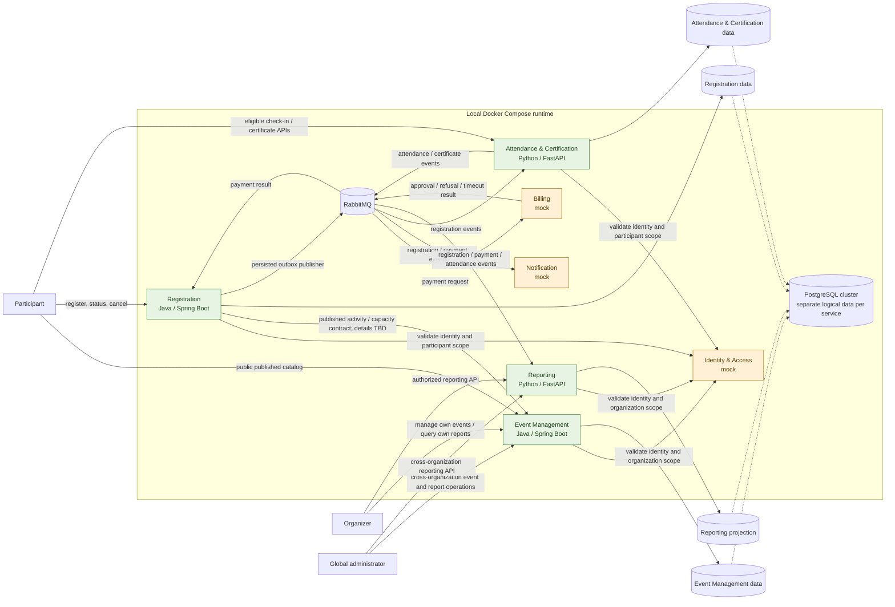

# EventHub context map

**Status:** candidate architecture for the prototype  
**Domain baseline:** [approved scenarios](domain-scenarios.md), version 1.0.0  
**Traceability:** RF01–RF11, RN01–RN07, RQ01–RQ08

EventHub evaluates seven candidate service boundaries. The runnable prototype
contains four domain services and three explicitly identified integration
mocks. A capability is not split into a service per requirement, and the mocks
do not represent production domain-service implementations.

## Context and dependency graph

Legend: green nodes are the four executable domain services; amber nodes are
the three integration mocks. The single PostgreSQL cluster is deployment
infrastructure only: each implemented service owns its own logical database
or schema and credentials. Dashed links indicate storage in that cluster, not
cross-service access.

## Interaction summary

| Producer | Consumer | Interaction | Boundary and purpose |
|---|---|---|---|
| Participant / organizer | Event Management | HTTP API | Public published catalog; event/activity management within authorization scope. |
| Participant | Registration | HTTP API | Request, query, and cancel own registrations; view reservation/offer state. |
| Registration | Event Management | Explicit API/contract to be finalized | Obtain published activity rules/capacity without reading Event Management data directly. Exact contract and capacity-update policy remain for ADRs/contracts (T008/T010/T012). |
| Protected domain services | Identity & Access mock | Identity validation contract | Resolve synthetic identity, role, and organization scope; each domain service enforces authorization. Exact token/API shape is T019/T020. |
| Registration | RabbitMQ | Asynchronous event publication | Persist registration/payment intent in its own outbox, then publish; do not make confirmation depend on Notification or Reporting. |
| Billing mock | RabbitMQ / Registration | Asynchronous request and result | Consume payment requests and publish configured approval, refusal, or timeout; Registration alone applies the corresponding state transition. |
| Registration | Notification mock | Asynchronous events | Record simulated delivery; notification failures do not undo or block a confirmed registration. |
| Registration | Attendance & Certification | Asynchronous registration events | Supply registration eligibility facts without database sharing. |
| Attendance & Certification | RabbitMQ / Reporting | Asynchronous attendance and certificate events | Record idempotent check-in and eligible certificate issuance; publish facts for the independent reporting projection. |
| Registration / Billing mock / Attendance & Certification | Reporting | Asynchronous events | Maintain Reporting's own eventually consistent read model; scope report queries by authorized organization. |

The approved domain rules are authoritative. Queue/exchange names, exact event
schemas, identity transport, retry/dead-letter behavior, and activity metadata
needed for certificate eligibility are contract decisions for the following
architecture/contract tasks; this map does not invent those wire details.

## Candidate deployment scope

| Candidate | Prototype treatment | Primary capability |
|---|---|---|
| Identity & Access | Contract + executable mock | Synthetic identity, roles, organization membership, and authorization facts. |
| Event Management | Executable Java service | Event and activity authoring/lifecycle and public published catalog. |
| Registration | Executable Java service | Capacity-safe registration lifecycle, payment wait, cancellation/refund, waitlist, and outbox. |
| Billing | Contract + executable mock | Simulate payment/refund approval, refusal, and timeout; no billing domain service. |
| Notification | Contract + executable mock | Consume notification-relevant events, record simulated delivery, and expose availability/failure scenarios. |
| Attendance & Certification | Executable Python service | Eligible idempotent check-in and certificate policy after activity completion. |
| Reporting | Executable Python service | Own event-fed projection and authorized operational indicators. |
