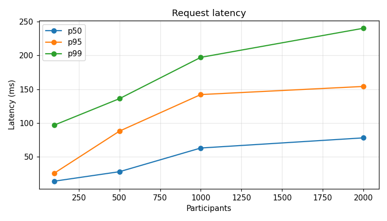
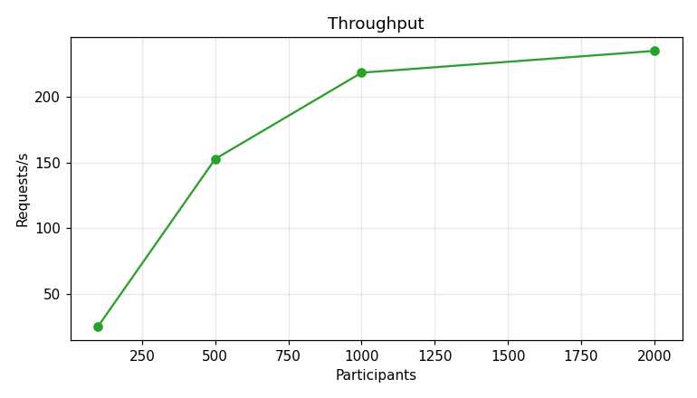
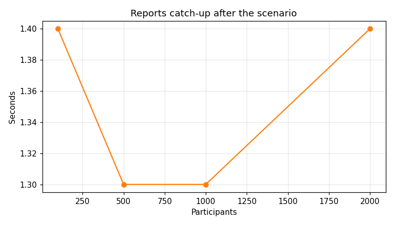
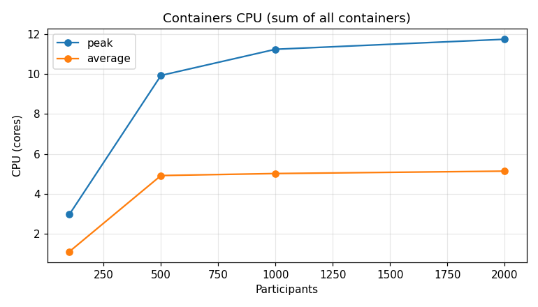
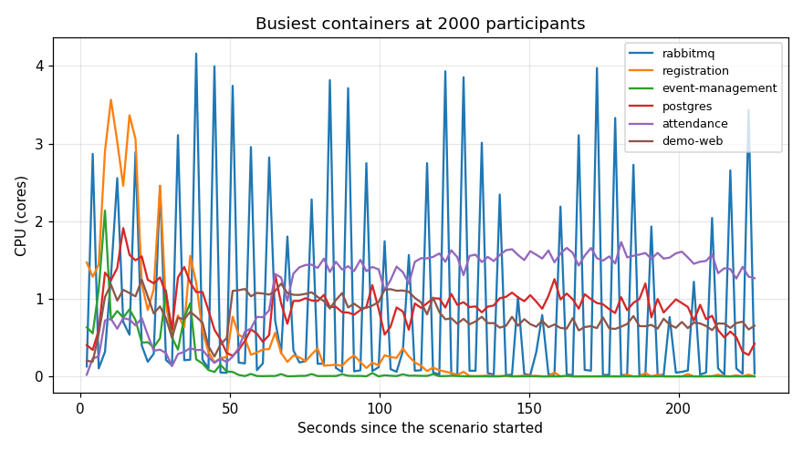

# Load benchmark

Started at 2026-11-12 17:14 UTC · commit `3d7ef4e` · command `bash scripts/benchmark.sh`

Each run executes every load scenario in parallel (`bash scripts/cenario.sh`) with the given
number of participants, after restoring the initial data (`scripts/reset-demo.sh`).

## Host

| Item | Value |
|---|---|
| CPU | AMD Ryzen 7 5800H with Radeon Graphics |
| Logical CPUs (host / Docker) | 16 / 16 |
| Memory (host / Docker) | 58.7 GiB / 58.7 GiB |
| OS | Linux 6.8.0-147-generic |
| Docker | 29.1.3 |

## Configuration

| Variable | Value |
|---|---|
| `SCENARIO_MIXED_DURATION_SECONDS` | 30 |
| `SCENARIO_CHECK_IN_MIN_PERCENT` | 40 |
| `SCENARIO_CHECK_IN_MAX_PERCENT` | 90 |
| `SCENARIO_CERTIFICATE_MIN_PERCENT` | 50 |
| `SCENARIO_CERTIFICATE_MAX_PERCENT` | 100 |
| `SCENARIO_CANCEL_PERCENT` | 20 |
| `SCENARIO_OFFER_LAPSE_PERCENT` | 20 |
| `REGISTRATION_OUTBOX_PUBLISH_INTERVAL_MS` | 1000 |
| `BILLING_MOCK_APPROVAL_DELAY_SECONDS` | (default) |
| `BILLING_MOCK_PAYMENT_REFUSAL_PERCENT` | 10 |
| `WAITLIST_OFFER_EXPIRY_MINUTES` | 1 |
| `HTTP_TIMEOUT_SECONDS` | 5 |

## Results

| Participants | Verdict | Scenario (s) | Requests/s | p50 / p95 / p99 (ms) | Failures | Resent | Reports catch-up (s) | Peak CPU (cores) | Peak memory (MiB) |
|---:|---|---:|---:|---|---:|---:|---:|---:|---:|
| 100 | OK | 35.8 | 25.9 | 14 / 26 / 97 | 0 | 0 | 1.4 | 2.97 | 1555.1 |
| 500 | OK | 37.7 | 152.6 | 28 / 88 / 136 | 0 | 0 | 1.3 | 9.93 | 1777.5 |
| 1000 | OK | 88.7 | 217.9 | 63 / 142 / 197 | 0 | 0 | 1.3 | 11.24 | 2127.5 |
| 2000 | VERIFICAR | 226.9 | 234.4 | 78 / 154 / 240 | 0 | 0 | 1.4 | 11.74 | 2199.1 |

Latency is the time each service took to answer the scenario's requests (local queueing
excluded). Catch-up is the time, after the scenario ended, until Reporting's counts match
Registration and Attendance. CPU is in cores (1.0 = one full CPU).

## Findings

- Highest load with every scenario OK: 1000 participants.
- First run that needs checking: 2000 participants (scenarios: carga-mista); see its log.
- At 2000 participants the containers used at most 11.7 of 16 CPUs (73%), 5.1 on average.
- Peak container memory: 2.1 GiB of 58.7 GiB (4%).
- Containers that reached about one full core (a single-threaded process at its limit is a likely bottleneck): attendance, demo-web, event-management, postgres, rabbitmq, registration.
- Request p95 went from 26 ms (100 participants) to 154 ms (2000); throughput from 25.9 to 234.4 requests/s.
- Reports caught up at most 1.4 s after the scenario ended (100 participants).

## Containers at 2000 participants

| Container | Avg CPU (cores) | Peak CPU (cores) | Peak memory (MiB) |
|---|---:|---:|---:|
| rabbitmq | 0.95 | 4.16 | 297.1 |
| registration | 0.41 | 3.56 | 862.8 |
| event-management | 0.14 | 2.14 | 700.9 |
| postgres | 0.9 | 1.91 | 190.4 |
| attendance | 1.18 | 1.73 | 70.9 |
| demo-web | 0.8 | 1.25 | 123.4 |
| reporting | 0.18 | 0.71 | 52.9 |
| billing-mock | 0.05 | 0.67 | 37.5 |
| notification-mock | 0.14 | 0.67 | 39.5 |
| identity-mock | 0.39 | 0.65 | 61.1 |

## Charts

## Files

- `runs.csv`: one row per run (all columns of the table above and more).
- `resources.csv`: every resource sample (containers and host) during each run.
- `logs/`: the full output of each scenario and reset.
