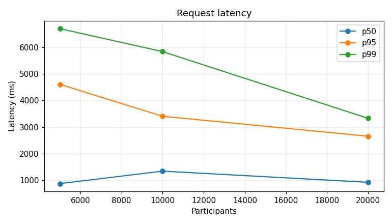
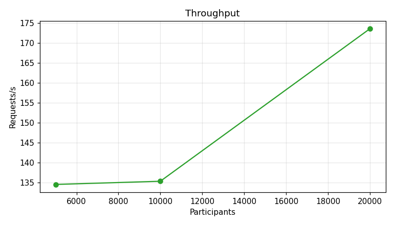
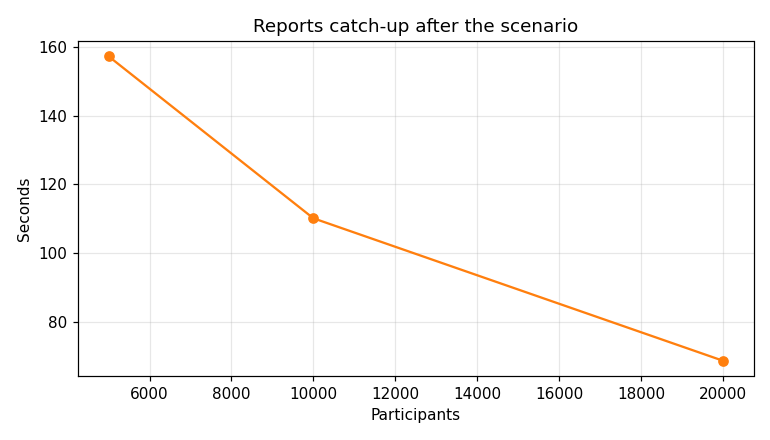
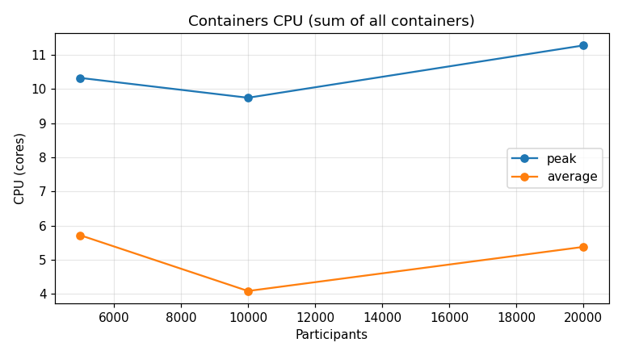
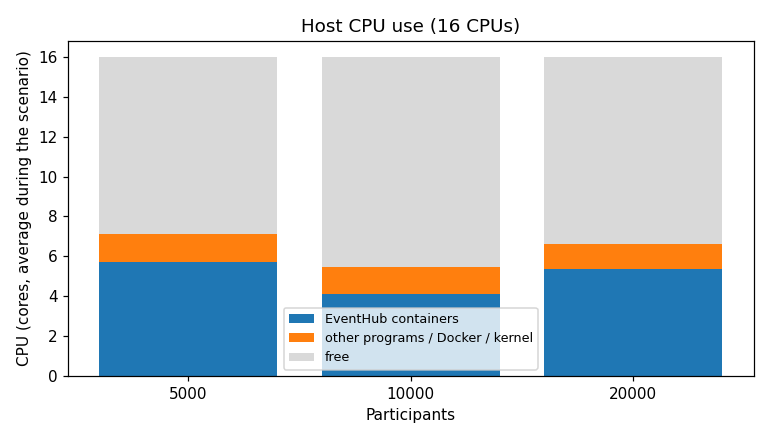
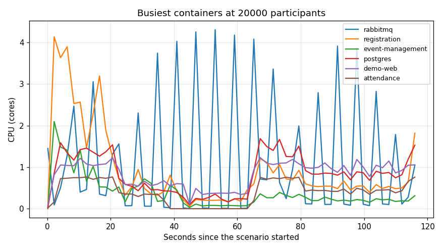

# Load benchmark

Started at 2026-11-12 19:37 UTC · commit `4492912` · command `bash scripts/benchmark.sh 5000 10000 20000 --scenario pico-inscricoes --connections 200`

Each run executes only the `pico-inscricoes` scenario (`bash scripts/cenario.sh pico-inscricoes`) with the given
number of participants, after restoring the initial data (`scripts/reset-demo.sh`).

## Host

| Item | Value |
|---|---|
| CPU | AMD Ryzen 7 5800H with Radeon Graphics |
| Logical CPUs (host / Docker) | 16 / 16 |
| Memory (host / Docker) | 58.7 GiB / 58.7 GiB |
| OS | Linux 6.8.0-147-generic |
| Docker | 29.1.3 |

## Configuration

| Variable | Value |
|---|---|
| `SCENARIO_PEAK_DURATION_SECONDS` | 30 |
| `SCENARIO_MIXED_DURATION_SECONDS` | 30 |
| `SCENARIO_CHECK_IN_MIN_PERCENT` | 40 |
| `SCENARIO_CHECK_IN_MAX_PERCENT` | 90 |
| `SCENARIO_CERTIFICATE_MIN_PERCENT` | 50 |
| `SCENARIO_CERTIFICATE_MAX_PERCENT` | 100 |
| `SCENARIO_CANCEL_PERCENT` | 20 |
| `SCENARIO_OFFER_LAPSE_PERCENT` | 20 |
| `SCENARIO_MAX_CONNECTIONS` | 200 |
| `REGISTRATION_OUTBOX_PUBLISH_INTERVAL_MS` | 1000 |
| `BILLING_MOCK_APPROVAL_DELAY_SECONDS` | (default) |
| `BILLING_MOCK_PAYMENT_REFUSAL_PERCENT` | 10 |
| `WAITLIST_OFFER_EXPIRY_MINUTES` | 1 |
| `HTTP_TIMEOUT_SECONDS` | 5 |

## Results

| Participants | Verdict | Scenario (s) | Requests/s | p50 / p95 / p99 (ms) | Failures | Resent | Reports catch-up (s) | Peak CPU (cores) | Peak memory (MiB) |
|---:|---|---:|---:|---|---:|---:|---:|---:|---:|
| 5000 | OK | 37.9 | 134.5 | 870 / 4610 / 6707 | 0 | 0 | 157.3 | 10.32 | 1984.1 |
| 10000 | OK | 74.7 | 135.3 | 1340 / 3406 / 5842 | 0 | 0 | 110.1 | 9.74 | 2025.5 |
| 20000 | OK | 116.1 | 173.6 | 919 / 2655 / 3328 | 5 | 5 | 68.6 | 11.27 | 2273.9 |

Latency is the time each service took to answer the scenario's requests (local queueing
excluded). Catch-up is the time, after the scenario ended, until Reporting's counts match
Registration and Attendance. CPU is in cores (1.0 = one full CPU).

## Host resources during each run

| Participants | Free at start (cores / GiB) | Other programs at start (cores) | Host CPU avg / peak (%) | Time at ≥90% CPU (%) | Background during run avg / peak (cores) | Waiting for CPU avg / peak (%) | Memory / disk stall peak (%) | Memory left (GiB) | Clock avg / min (MHz) | Limit |
|---:|---|---:|---|---:|---|---|---|---:|---|---|
| 5000 | 14.0 / 45.8 | 1.06 | 43.98 / 76.0 | 0.0 | 1.38 / 2.41 | 5.99 / 25.5 | 0.0 / 9.7 | 45.2 | 4017.0 / 3790.0 | architecture |
| 10000 | 14.37 / 45.8 | 0.82 | 33.68 / 64.0 | 0.0 | 1.36 / 3.4 | 3.72 / 15.7 | 0.0 / 11.9 | 45.1 | 4044.0 / 3670.0 | architecture |
| 20000 | 14.34 / 45.8 | 1.23 | 40.41 / 77.9 | 0.0 | 1.24 / 3.55 | 5.88 / 25.8 | 0.0 / 23.9 | 44.8 | 4044.0 / 3249.0 | architecture |

*Free at start* and *other programs* come from an idle sample of the host taken just before
the scenario (the stack running, no load). *Background during run* is host CPU not used by
the EventHub containers: other programs plus the Docker engine and kernel networking.
*Waiting for CPU* and the *stall* columns come from the kernel (`/proc/pressure`): the share
of time at least one task was ready but waiting for a CPU, memory or the disk.

Limit: *host* when the CPU stayed at or above 90% in at least 25% of the samples, tasks waited for a CPU 25% of the time or more on average, memory stalls reached 10%, or less than 5% of the memory was left; *noisy* when other programs used 15% of the CPUs or more before the run; otherwise *architecture* (the host had spare capacity, so the stack's design set the limit).

## Findings

- Highest load with every scenario OK: 20000 participants.
- At 20000 participants the containers used at most 11.3 of 16 CPUs (70%), 5.4 on average.
- Peak container memory: 2.2 GiB of 58.7 GiB (4%).
- Containers that reached about one full core (a single-threaded process at its limit is a likely bottleneck): demo-web, event-management, postgres, rabbitmq, registration.
- Request p95 went from 4610 ms (5000 participants) to 2655 ms (20000); throughput from 134.5 to 173.6 requests/s.
- Reports caught up at most 157.3 s after the scenario ended (5000 participants).
- Requests resent after a timeout (same Idempotency-Key): 5 in total.
- What limited each run: 5000 → architecture; 10000 → architecture; 20000 → architecture.
- The machine never saturated: the limits observed come from the stack's design (one instance per service), not from this host.
- CPU clock at 20000 participants: 4044.0 MHz on average, 3249.0 MHz at the lowest (idle before the run: 3804 MHz; maximum 4463 MHz).

## Containers at 20000 participants

| Container | Avg CPU (cores) | Peak CPU (cores) | Peak memory (MiB) |
|---|---:|---:|---:|
| rabbitmq | 1.15 | 4.31 | 293.1 |
| registration | 0.91 | 4.14 | 753.1 |
| event-management | 0.38 | 2.1 | 752.8 |
| postgres | 0.83 | 1.69 | 184.8 |
| demo-web | 0.82 | 1.23 | 161.3 |
| attendance | 0.4 | 0.77 | 54.5 |
| notification-mock | 0.22 | 0.74 | 35.2 |
| reporting | 0.34 | 0.7 | 52.7 |
| identity-mock | 0.29 | 0.56 | 66.4 |
| billing-mock | 0.03 | 0.36 | 40.5 |

## Charts

## Files

- `runs.csv`: one row per run (all columns of the table above and more).
- `resources.csv`: every resource sample (containers and host) during each run; on the
  `host` rows `cpu_cores` is the host CPU % and `mem_mib` the used memory. Phases:
  `baseline` (idle, before the scenario), `scenario` and `catch-up`.
- `logs/`: the full output of each scenario and reset.
