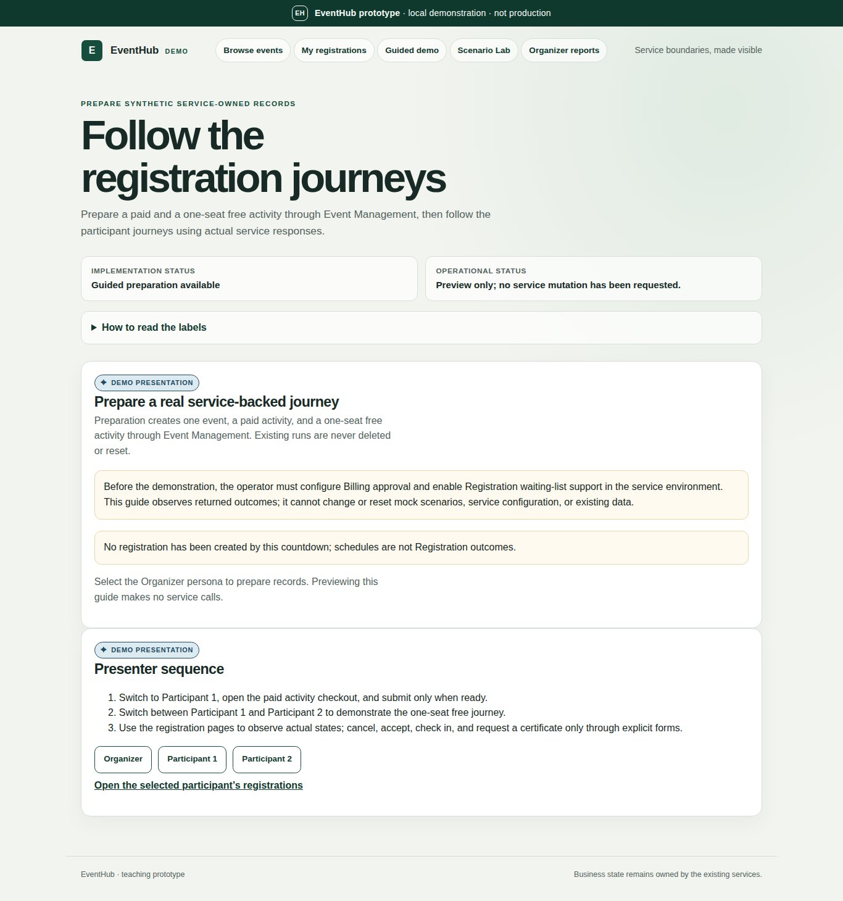
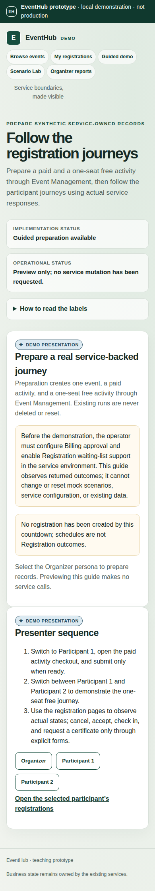
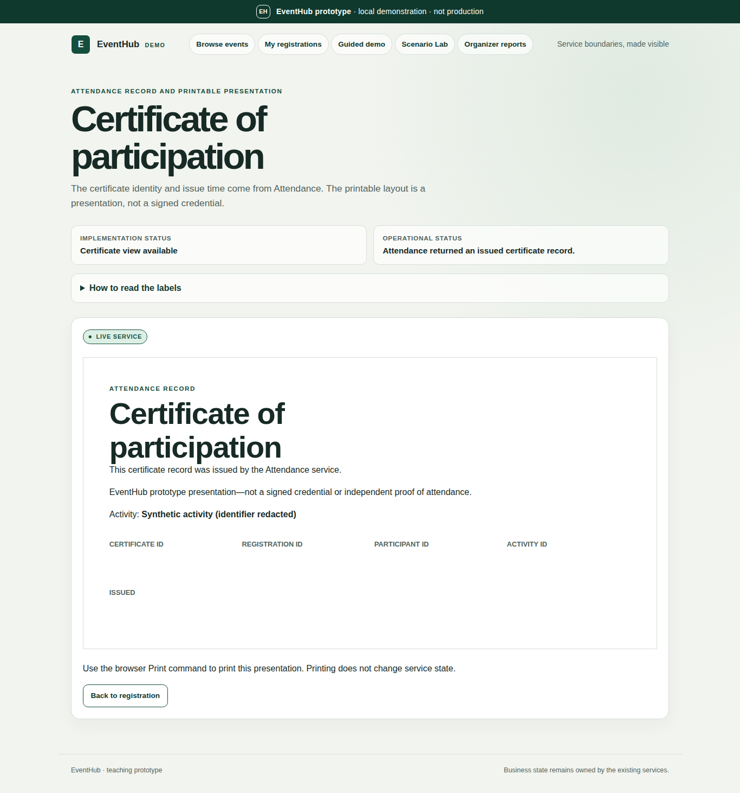

# Demo Web browser validation evidence

**Tasks:** T078, T080
**Execution date:** 2026-11-11
**Scope:** Isolated browser acceptance, presentation viewport checks, Scenario
Lab read-back exports, recovery behavior, the presentation adapter architecture
view, and a fresh-data browser rehearsal. This is local prototype evidence, not
a production readiness or security certification.

> **Revision:** this record documents the run before the role-based
> restructure. The guided demo page and the in-browser Scenario Lab described
> below were later removed. The same fixed scenarios now run from the terminal
> (`bash scripts/cenario.sh …`), and the browser acceptance suite now drives
> the organizer pages (3 passed, 2 skipped; both outage probes passed). See the
> [presentation script](./webapp-presentation-script.md).

## Environment and versions

| Component | Version / configuration |
|---|---|
| Docker Engine | 29.1.3 |
| Docker Compose | 2.40.3 |
| Demo Web runtime base | `python:3.12.9-slim-bookworm` |
| Browser test image | `mcr.microsoft.com/playwright/python:v1.63.0-noble` |
| Browser test Python | 3.12.3 |
| Playwright Python package | 1.63.0 |
| Chromium | Google Chrome for Testing 153.0.8010.12 |
| Repository Python suite | pytest 8.3.5 in the Docker test image |
| Architecture export renderer | PlantUML 1.2025.4 |
| Local service dependencies | PostgreSQL 16.6 Alpine and RabbitMQ 3.13.7 Management Alpine |

The browser and app run in containers; no host Node or browser installation is
required. Docker Compose emitted its existing warning that buildx is absent
and used the Docker builder; the browser and test-profile builds completed.

## Validation results

| Gate | Command | Result |
|---|---|---|
| Host Python suite | `.venv/bin/python -m pytest -x --import-mode=importlib` | Exit 0; **406 passed, 10 skipped** in 8.20 s; one existing Starlette/AnyIO deprecation warning. |
| Canonical Python suite | `EVENTHUB_ENV_FILE=infra/.env.example bash scripts/test-demo-web.sh` | Exit 0; **406 passed, 10 skipped**, one existing Starlette/AnyIO deprecation warning; pytest elapsed 9.54 s. |
| Browser journeys | `bash tests/webapp/run.sh` | Exit 0; **4 passed, 2 skipped** in 77.00 s. The skips are the controlled outage probes executed separately below. |
| Reporting outage and recovery | Run script stops Reporting, executes its browser failure probe, then waits for service recovery. | Exit 0; **1 passed** in 0.71 s. |
| Identity outage and recovery | Run script stops Identity, executes its browser failure probe, then waits for service recovery. | Exit 0; **1 passed** in 0.79 s. |
| Complete Compose test-profile image build | `docker compose --env-file infra/.env.example -f infra/docker-compose.yml --profile test build` | Exit 0. Java and Python service/mock test images built; this command builds images and does not itself execute Java tests. |
| Lint, format, import boundaries | `.venv/bin/ruff check --no-cache tests/webapp/test_paid_journey.py tests/webapp/test_scenario_lab.py && .venv/bin/ruff format --check --no-cache tests/webapp/test_paid_journey.py tests/webapp/test_scenario_lab.py && .venv/bin/lint-imports --no-cache` | Exit 0. |

The 10 skips in both Python suite runs are environment-dependent tests; they
are not counted as passes. Both runs used fail-fast `-x` and reported the same
406/10 result. The live browser suite independently exercised the paid,
waitlist, Scenario Lab, and failure/isolation paths relevant to this adapter.

## Browser and viewport evidence

The paid journey uses a fresh synthetic event/activity, submits the paid
registration once despite a double click, reads back confirmation, checks in,
verifies early certificate issuance is rejected, waits for the actual activity
end, and reads back the issued certificate. The waitlist journey uses separate
browser contexts and confirms the real offer/acceptance transition. Browser
tests also check keyboard actions, print behavior, report projection fields,
failure visibility, and browser error output.

The page was checked at **1366×768** projector size and **390×844** narrow
mobile size. The browser test asserted that neither viewport has horizontal
document overflow; the screenshots were also visually reviewed. Certificate
field values and the generated activity identifier are redacted in the
certificate screenshot; its real-service status and record layout remain
visible. The other captures show only the synthetic Guided demo preview.

## Scenario Lab run exports

The isolated real-browser run exported the completed run observations through
the app's read-only export endpoint. The export path asserts that no token text
is present before writing each file.

| Preset | Export | Observed outcome |
|---|---|---|
| Last seat | [scenario-last-seat.json](artifacts/webapp/scenario-last-seat.json) | Two-way contention for capacity 1; one confirmed and one waitlisted before continuation; explicit cancellation, FIFO offer, and acceptance completed with the expected verdict. The exported final read-back shows one cancelled and one confirmed registration, capacity 1 occupied. |
| Registration rush | [scenario-registration-rush.json](artifacts/webapp/scenario-registration-rush.json) | 20 distinct requests; capacity 5, five confirmed, fifteen waitlisted, final occupied count 5. |
| Duplicate submission | [scenario-duplicate-submission.json](artifacts/webapp/scenario-duplicate-submission.json) | 10 same-key requests; one registration record and occupied count 1. |

These are synthetic run records with generated identifiers and participant
labels. They contain no service credentials or real participant data. The
exports preserve correlation and registration IDs to make the read-back
traceable within each isolated run.

## Data isolation and recovery

`tests/webapp/run.sh` reads the safe `infra/.env.example` template and creates a
temporary test-only settings file. It uses a PID-specific Compose project, an
internal-only browser overlay that resets published ports, and fresh
project-scoped volumes. Each run prepares new synthetic records; it does not
read, overwrite, reset, or delete data from the default project or the user's
`infra/.env`. The script removes only its own project and temporary settings.

Both controlled outage probes passed. Reporting and Identity were each brought
back with Compose's readiness wait before proceeding; the exit trap also
attempts restoration if a probe fails. The isolated project was removed during
normal teardown. No unknown host listener or shared service was stopped.

## Architecture and known limits

The [container diagram source](../architecture/containers.puml), its
[PNG export](../architecture/services.png), and the
[context map](../architecture/context-map.md) now show Demo Web as an optional,
server-rendered presentation adapter. It calls the four domain HTTP APIs using
server-side synthetic persona fixtures; it owns no domain state and has no
database or broker access.

One earlier live observation showed the organizer projection with confirmed
and checked-in counts but zero certificates even after the Attendance
certificate record was successfully read back. The browser acceptance asserts
the confirmed/check-in projection, not a certificate count. This remains a
possible asynchronous Reporting projection gap and is not presented as a
successful certificate-count observation.

The prototype uses local services and explicit Identity, Billing, and
Notification mocks. A successful local run is not evidence of production
provider behavior, statistically reliable capacity, a latency SLA, or
production readiness. Mutation scores remain those in the existing
[mutation-testing evidence](./mutation-testing.md); this task changes no domain
service implementation or invariant.

## T080 fresh-data presentation-flow rehearsal

The browser presentation flow was rehearsed against fresh synthetic records
using the documented isolated runner, `bash tests/webapp/run.sh`. Its optional
`WEBAPP_TEST_ARTIFACTS_HOST_DIR` was redirected to temporary session storage so
the existing checked-in evidence artifacts were preserved.

The runner created an ephemeral settings file from `infra/.env.example`, a
PID-scoped Compose project, and fresh project volumes. It did not read or modify
`infra/.env`, use the already-running default project, or retain rehearsal
artifacts in the repository. The test settings accelerated the schedule to a
paid start 40 seconds after preparation, a 30-second paid activity, and a free
start 90 seconds after preparation; these are test-only overrides. The
presentation example remains 180/60/900 seconds. The runner used the bounded
Scenario Lab limits listed above.

| Rehearsal gate | Observed result |
|---|---|
| Host Python suite | **406 passed, 10 skipped** in 8.00 seconds using `.venv/bin/python -m pytest -x --import-mode=importlib`. |
| Canonical Python suite | **406 passed, 10 skipped** in 9.57 seconds using `EVENTHUB_ENV_FILE=infra/.env.example bash scripts/test-demo-web.sh`. |
| Real-browser journeys | **4 passed, 2 skipped** in 77.54 seconds. The two controlled outage checks are separate gates below, not unverified passes. |
| Reporting outage and recovery | **1 passed** in 0.78 seconds. |
| Identity outage and recovery | **1 passed** in 0.87 seconds. |
| Compose test-profile image build | Complete test-profile build succeeded. |
| Lint, format, import boundaries | Ruff checks and formatting passed; import-linter analyzed 81 files and reported 0 broken contracts. |
| Paid journey | Preparation, confirmed registration, reload/read-back, check-in, pre-end certificate rejection, post-end issuance/read-back, print view, and report projection completed. |
| Two-person waitlist | Independent browser contexts observed `CONFIRMED`, `WAITLISTED`, `CANCELLED`, `OFFERED`, and explicit acceptance to `CONFIRMED`; the second session could not read the first participant's registration. |
| Last-seat lab run | 2 dispatches, peak concurrency 2, capacity 1, no errors or unknowns, `EXPECTED`; observed 381 ms. FIFO offer/acceptance completed, with one occupied place in final read-back. |
| Registration-rush lab run | 20 dispatches, peak concurrency 10, capacity 5, five confirmed and fifteen waitlisted, no errors or unknowns, `EXPECTED`; observed 555 ms. |
| Duplicate-submission lab run | 10 same-key dispatches, peak concurrency 10, one confirmed registration in read-back, no errors or unknowns, `EXPECTED`; observed 312 ms. |

These are timings for automated browser checks and bounded local lab requests,
not the duration of a spoken presentation or a production performance
measurement. The full, happy-path, and short presenter durations remain
targets, not measured human talk times. Service responses and returned
`Starts`/`Ends` remain authoritative; the runner's accelerated schedule must
not be copied into a live presentation configuration. The three Scenario Lab
measurements are single synthetic samples, not an SLA or capacity guarantee.
